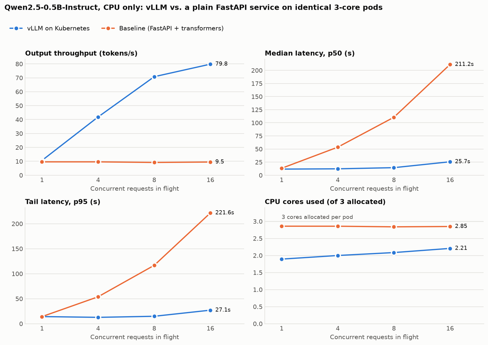
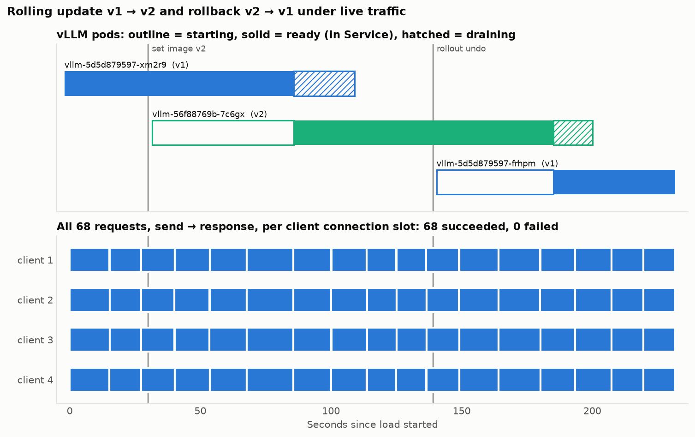
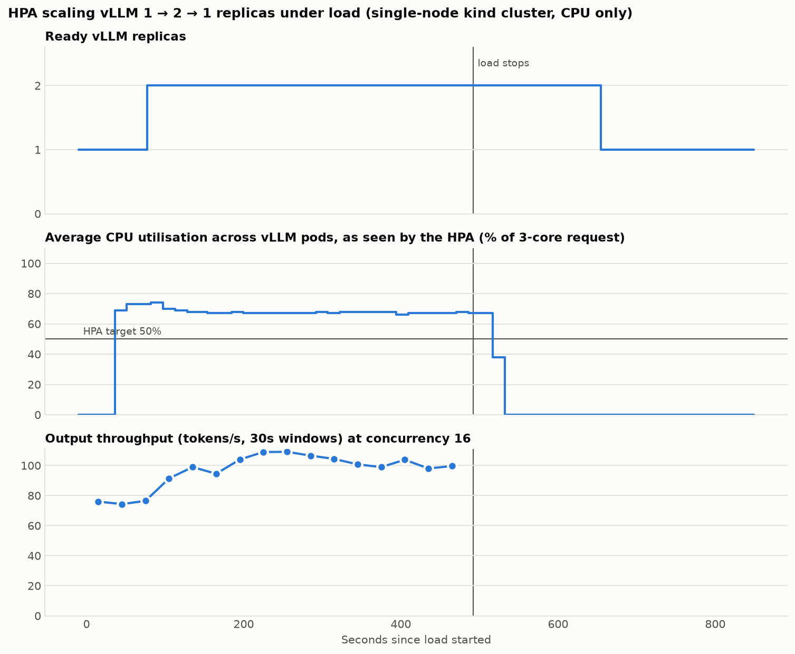
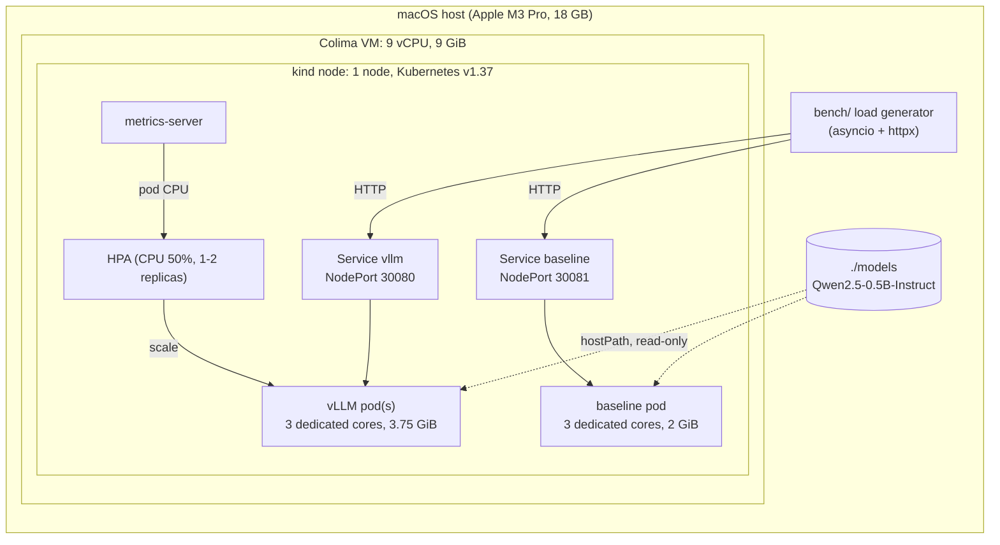

# KubeServe

An open-source LLM (**Qwen2.5-0.5B-Instruct**) served with **vLLM**'s OpenAI-compatible
server on a **local, single-node Kubernetes cluster (kind)**, with a HorizontalPodAutoscaler
and zero-downtime rolling updates. It is benchmarked against a **baseline**: the same model
in a plain FastAPI + Hugging Face `transformers` service, on identical pods, to measure how
much a dedicated inference engine adds.

> [!IMPORTANT]
> **Scope: read this before quoting any number.**
> - **CPU only. No GPU was used.** The machine is an Apple M3 Pro laptop with no NVIDIA GPU,
>   and vLLM cannot use the Apple GPU from inside a Linux container. vLLM runs on its **CPU
>   backend**. Every "utilisation" number is **CPU** utilisation; there are no GPU numbers here.
> - **Single-node, local cluster.** One kind node (control plane and worker in the same
>   container) inside a Colima VM on a laptop. It is not a multi-node or production cluster.
> - **Small model.** 0.5B parameters, chosen because of memory (see
>   [why 0.5B](#why-05b)).
> - **Laptop numbers.** The benchmarks share the machine with a desktop session, so absolute
>   throughput is noisy and far below any GPU server. The *ratio* between vLLM and the
>   baseline on identical resources is the meaningful result.

<!-- results:start (generated by bench/report.py; do not edit) -->
## Results

Qwen2.5-0.5B-Instruct, bfloat16, **CPU only**. Each server gets one pod with 3 dedicated cores. Requests generate exactly 128 tokens each. Runs: vLLM 2 complete sweeps, baseline 1 complete sweep (means shown). Full tables are in [`results/results.md`](results/results.md) and the data in [`results/`](results/).

- **At 16 concurrent requests, vLLM delivered 8.4× the baseline's throughput** (79.8 vs. 9.5 output tokens/s) with **8.2× lower p95 latency** (27.1 s vs. 221.6 s), while using fewer CPU cores (2.21 vs. 2.85): 11× more tokens per core-second.
- **With a single request in flight there is little difference** (1.10× throughput, 10.6 vs. 9.6 tok/s). vLLM's gain comes from continuous batching, which needs concurrent requests to batch.
- The baseline's throughput stays flat (~9.2–9.6 tok/s) at every concurrency because it runs one `generate()` at a time. Its latency grows with the queue instead, reaching p50 211 s at concurrency 16.
- Failed requests: 0 of 128 (baseline), 0 of 256 (vLLM).

| Concurrency | Baseline tok/s | vLLM tok/s | Throughput gain | Baseline p50 / p95 (s) | vLLM p50 / p95 (s) | p95 latency reduction | CPU cores used, baseline / vLLM |
|---:|---:|---:|---:|---:|---:|---:|---:|
| 1 | 9.6 | 10.6 | **1.10×** | 13.2 / 14.1 | 11.7 / 14.2 | **0.99×** | 2.86 / 1.89 |
| 4 | 9.6 | 41.9 | **4.36×** | 53.5 / 53.8 | 12.2 / 12.7 | **4.24×** | 2.86 / 2.00 |
| 8 | 9.2 | 70.8 | **7.71×** | 110.5 / 116.8 | 14.4 / 14.8 | **7.88×** | 2.84 / 2.08 |
| 16 | 9.5 | 79.8 | **8.42×** | 211.2 / 221.6 | 25.7 / 27.1 | **8.19×** | 2.85 / 2.21 |



<!-- results:end -->

## Rolling update demo: zero dropped requests

`make rolling-update-demo` ([`bench/rolling_update_demo.py`](bench/rolling_update_demo.py))
keeps 4 requests in flight against the vLLM Service. During that load it changes the
image (`kubectl set image … kubeserve-vllm:v2`), then rolls back (`kubectl rollout undo`
→ `v1`). Evidence is in [`results/rolling_update/`](results/rolling_update/).

**Result: 68 of 68 requests succeeded, 0 failed, across both rollouts.**



| | |
|---|---|
| Requests sent / succeeded / failed | 68 / 68 / **0** (every response HTTP 200 with 128 tokens) |
| Served by each pod (from the pods' own access logs) | old v1 `…xm2r9`: 27 · v2 `…7c6gx`: 29 · new v1 `…frhpm`: 12 (sum = 68) |
| New pod: container start → passes readiness | 54 s (v2), 45 s (rollback) |
| Old pod: terminating → gone (preStop 10 s + drain) | 23 s, 15 s |
| Latency during the demo | p50 13.5 s, max 17.8 s (the slowest requests overlap the new pod's startup, which competes for the laptop's CPU) |
| `kubectl rollout history` | [`rollout_history.txt`](results/rolling_update/rollout_history.txt): revision 3 = v2, revision 4 = rollback to v1 |

Two things are specific to this setup. The baseline is scaled to 0 and the HPA capped at
1 replica during the demo, because the node has room for exactly one surge pod. The
client opens a new connection per request (see [design decisions](#design-decisions)).
A client that reuses keep-alive connections is not covered by this test.

## Autoscaling demo: HPA scales 1 → 2 → 1

`make hpa-demo` ([`bench/hpa_demo.py`](bench/hpa_demo.py)) starts from one idle vLLM
replica, applies 8 minutes of closed-loop load at concurrency 16, then watches for 6
minutes after the load stops. The HPA status is recorded every 5 s. Evidence is in
[`results/hpa/`](results/hpa/), including the HPA's own events in
[`describe_hpa.txt`](results/hpa/describe_hpa.txt):
`New size: 2; reason: cpu resource utilization (percentage of request) above target`, then
`New size: 1; reason: All metrics below target`.



| Event (seconds after load started) | |
|---|---|
| HPA decides to scale up (CPU 69% of request vs. 50% target) | 36 s |
| Second replica passes readiness and joins the Service | 77 s |
| Load stops | 492 s |
| HPA decides to scale down (after its 120 s stabilisation window) | 634 s |
| Back to one replica | 655 s |
| Requests during the demo | 369 sent, 369 succeeded, 0 failed |

**Throughput rose from 74 tok/s with one replica to 101 tok/s with two (1.36×), not 2×.**
That is a single-node limit, not a Kubernetes one. Each pod has its own 3 cores *inside the
VM*, but all of the VM's vCPUs run on the same laptop CPU (5 performance + 6 efficiency
cores), shared with macOS. When both pods are busy, macOS has to put some of their vCPUs on
slower cores. On a real cluster the second replica would land on another node's hardware. The
`FailedGetResourceMetric` warnings in the HPA events are from moments when a pod was still
starting and metrics-server had no data for it yet.

## Benchmark methodology

| | |
|---|---|
| Servers | vLLM 0.31.0 (CPU backend) vs. FastAPI + `transformers` 5.17 / `torch` 2.13 (the same library versions as the vLLM image). Both run on Kubernetes behind NodePort Services and are reached the same way |
| Resources | one pod each, **3 exclusive cores** (static CPU manager, Guaranteed QoS). vLLM: 3.75 GiB limit; baseline: 2 GiB. The HPA is pinned to 1 replica during the benchmark, so it is engine vs. engine |
| Model / numerics | Qwen2.5-0.5B-Instruct, bfloat16 in both; greedy decoding, no repetition penalty |
| Requests | `/v1/chat/completions`, non-streaming; 24 fixed prompts (~43 prompt tokens after the chat template); **exactly 128 output tokens** per request (`ignore_eos` / `min_new_tokens`, verified from each response's `usage`) |
| Load pattern | closed loop with *c* workers, each sending its next request as soon as the last returns; *c* = 1, 4, 8, 16; N = max(16, 4·*c*) requests per level; 2 warm-up requests first |
| Repeats | **vLLM: 2 complete sweeps; baseline: 1 complete sweep.** A second baseline sweep was attempted, but the laptop kept sleeping on battery and all 5 attempts at its first level were rejected. The baseline varies little between runs: an earlier sweep, interrupted by a sleep at concurrency 8, measured 9.8 and 10.2 tok/s at concurrency 1 and 4, against 9.6 and 9.6 in the complete sweep ([`results/rejected/`](results/rejected/)). Tables show means; `results/results.md` shows vLLM's run-to-run range (throughput within 7%) |
| Throughput | successful requests ÷ wall time, and output tokens ÷ wall time (first send to last response) |
| Latency | end-to-end time per request, **including time queued** in the server; p50/p95 by linear interpolation |
| CPU utilisation | from each pod's cgroup `cpu.stat` (`usage_usec`), sampled every 2 s via `kubectl exec`; reported as cores used and % of the 3-core allocation. **No GPU, so no GPU utilisation** |
| Validity checks | 0 failed requests required; a run during which the laptop slept is detected (wall clock vs. awake-only clock) and re-run; rejected attempts are kept in [`results/rejected/`](results/rejected/) |

Limitations: 16–64 requests per level, so p95 rests on few samples. Non-streaming, so time to
first token is not measured. One prompt-length and output-length shape only. The load generator
runs on the same laptop. Open-loop (Poisson) arrivals were not tested.

## Architecture



| Piece | What it is |
|---|---|
| [`serving/vllm/`](serving/vllm/) | `vllm/vllm-openai-cpu:v0.31.0-arm64` plus a version stamp and one small, documented patch ([problem 3](#problems-hit-and-how-they-were-fixed)) |
| [`serving/baseline/`](serving/baseline/) | FastAPI + `transformers`, one process; `generate()` calls run one at a time (no batching) |
| [`k8s/vllm/`](k8s/vllm/) | Deployment (rolling-update strategy, probes, graceful drain), NodePort Service, HPA |
| [`k8s/baseline/`](k8s/baseline/) | Deployment + NodePort Service with the same CPU allocation |
| [`k8s/metrics-server/`](k8s/metrics-server/) | metrics-server v0.9.0 (kustomize, patched for kind's self-signed kubelet certs) |
| [`cluster/`](cluster/) | kind config: one node, model mount, port mappings, **static CPU manager** |
| [`bench/`](bench/) | load generator, cgroup CPU/memory sampler, benchmark sweep, report, HPA and rolling-update demos |
| [`results/`](results/) | everything the scripts produced: raw per-request data, summaries, charts, logs |

## Design decisions

**Identical, isolated resources for both servers.** The kubelet runs the **static CPU
manager**. Both deployments are Guaranteed QoS (requests = limits, integer CPUs), so each pod
gets **3 exclusive cores**: its own cpuset, which no other pod can run on. The
benchmark compares engine against engine on the same hardware. The baseline uses all 3
cores for PyTorch. vLLM binds 2 OpenMP compute threads and keeps 1 core for its
scheduler and API server (its default CPU policy).

**Same model, same work per request.** Both serve the same weights in bfloat16 (the VM's CPU
exposes `bf16`/`i8mm`). Both use greedy decoding with no repetition penalty (vLLM runs with
`--generation-config vllm`, so it ignores the model's sampling defaults). Every benchmark
request generates exactly 128 tokens.

**vLLM tuned for a small CPU pod, with each choice measured before it was adopted:**

| Setting | Why |
|---|---|
| `--enforce-eager` | torch.compile gave no throughput gain on this CPU (single stream 12.6 vs. 13.0 tok/s eager; 64 vs. 69 tok/s at 8 concurrent) and doubled startup (66 s vs. 34 s) |
| `VLLM_ENABLE_V1_MULTIPROCESSING=0` | engine core runs inside the API-server process: ~3.4 instead of ~3.9 GiB per replica, same or slightly higher throughput (13.7 vs. 13.0 tok/s single stream). On a GPU you would keep the separate process |
| `--kv-cache-memory-bytes=256Mi` | ~21k tokens of KV cache, far more than 32 sequences × ~170 tokens need. Together with eager mode this took a replica from 5.3 to 3.9 GiB (most of the saving is the smaller KV cache) |
| `--shutdown-timeout=60` | on SIGTERM, finish in-flight requests. vLLM's help documents the default as `0 = abort`, so in-flight requests would be cut off at every rollout (inferred from the docs; not tested separately) |
| `/dev/shm` as a memory `emptyDir` | vLLM needs more than the 64 MiB a container gets by default |
| `enableServiceLinks: false` | a Service called `vllm` makes Kubernetes inject `VLLM_PORT=tcp://…`, which vLLM reads as its own setting and crashes |

**Zero-downtime rollouts.** `maxSurge: 1, maxUnavailable: 0`, so the new pod must pass its
readiness probe (`/health`) before an old pod is removed. `preStop: sleep 10` keeps the old
pod serving while its endpoint removal reaches kube-proxy. `--shutdown-timeout=60` drains
in-flight requests, and `terminationGracePeriodSeconds: 90` covers both.

**Autoscaling on CPU.** An idle vLLM pod uses about 1–2% of its 3 cores and a busy one about
65–75%, so a 50% target splits the two cleanly. This works here but is not what you would do
in production; see [differences from production](#how-this-differs-from-production).

**Load generator opens a new connection per request.** A Kubernetes Service balances TCP
*connections*, not requests. A client with pooled keep-alive connections stays pinned to the
pods that existed when it connected and never reaches a replica the HPA adds later. Requests here
take 10+ seconds, so the connection setup cost is negligible.

## Problems hit and how they were fixed

These came up during the build. Each was diagnosed from logs and measurements, and each
makes a useful interview story.

1. **Host memory thrashing invalidated the first measurements.** With a 1.5B model and a 13 GB
   VM on an 18 GB laptop, macOS swapped the VM (21.8 of 22.5 GB swap used). Plain
   `transformers` managed 3.2 tok/s and fp32 0.7 tok/s, which were measurements of swap, not
   of the model. Fixed by resizing everything to fit (next item) and re-measuring.
2. <a id="why-05b"></a>**Why Qwen2.5-0.5B and not 1.5B.** A vLLM CPU replica of Qwen2.5-1.5B measured
   **~7.2 GiB** with default settings (3.1 GB of weights, a 1 GiB KV cache, three Python processes).
   The HPA demo and the rollout surge both need **two replicas at once**. Even with the memory
   settings below, two 1.5B replicas would need well over the ~9 GiB this 18 GB laptop can give
   the VM next to macOS (an estimate; not measured). With the 0.5B model, a replica is ~3.4 GiB,
   so two fit on the 9 GiB node.
3. **vLLM crash-looped in Kubernetes but not in Docker.** vLLM 0.31 checks the KV cache against
   `memory.max − memory.current` of its cgroup. `memory.current` includes the **page cache** from
   reading the weights (~850 MB), which is reclaimable, and that cache stays charged to the pod
   across container restarts. So the pod always looked full ("0.02/3.75 GiB available").
   [`serving/vllm/patch_cgroup_memory.py`](serving/vllm/patch_cgroup_memory.py) makes vLLM use the
   cgroup **working set** (`memory.current − inactive_file`, what the kubelet uses). The patch is
   applied at image build time and fails the build if the vLLM source changes.
4. **`VLLM_PORT 'tcp://10.96.x.x:8000' appears to be a URI`.** This came from Kubernetes service
   links (see the table above).
5. **A rollout stuck with a Pending pod.** The node has 8 allocatable cores. The baseline (3),
   the old vLLM pod (3) and the control plane's requests (~1) left no room for a 3-core surge pod.
   `maxUnavailable: 0` correctly refused to kill the old pod first. The demos scale the baseline
   to 0 to make room.
6. **The HPA scaled vLLM during the engine benchmark.** That would have pitted two vLLM pods
   against one baseline pod. The benchmark now pins the HPA to one replica while it runs.
7. **The laptop went to sleep in the middle of benchmarks** (lid closed). The first time it
   produced an obviously wrong point: 18 tok/s at concurrency 16, against 69 at concurrency 8,
   while the pod averaged 0.4 busy cores. After that, the load generator compares the wall clock
   with an awake-only clock (`CLOCK_UPTIME_RAW`). If the host slept, it aborts the attempt and the
   benchmark re-runs that level. Since then it has rejected 7 attempts (sleeps of 25 s to 338 s) instead
   of recording them. With `caffeinate -is` on AC power, a lid close only turned the display off
   ("DarkWake" in `pmset -g log`) and the request timeline shows no gap. On battery a closed lid still
   sleeps the Mac, which is why the baseline has one complete sweep instead of two. The rejected runs and their logs are in
   [`results/rejected/`](results/rejected/).

## Reproduce it

Tested on macOS 27 (Apple M3 Pro, 18 GB) with Colima 0.10.3, Docker 29.5, kind 0.33
(Kubernetes 1.37) and uv 0.12. It needs ~10 GB of free RAM and ~15 GB of disk, and should
run on any arm64 machine with Docker. On x86-64, change the base image tag in
`serving/vllm/Dockerfile` to `-x86_64` (not tested).

```bash
# Tools (macOS): Docker runtime + CLI, kind, kubectl, uv
brew install colima docker docker-buildx kind kubectl uv

make vm        # Colima VM: 9 vCPU, 9 GiB (skip on Linux with Docker)
make model     # download Qwen2.5-0.5B-Instruct into ./models (~1 GB)
make cluster   # single-node kind cluster + metrics-server
make images    # build vLLM v1/v2 + baseline images, load them into kind
make deploy    # vLLM Deployment/Service/HPA + baseline Deployment/Service

make bench               # 2 interleaved sweeps (~1 h): results/raw/, results/results.{json,md}, README table
make rolling-update-demo # ~5 min: results/rolling_update/
make hpa-demo            # ~15 min: results/hpa/

make down vm-stop        # delete the cluster, stop the VM
```

`make bench` pins the HPA to one replica; `make hpa-demo` (or `kubectl apply -k k8s/vllm`)
restores its 1–2 range. Keep the machine awake, and ideally plugged in, while benchmarks run.

Smoke test once deployed:

```bash
curl -s localhost:30080/v1/chat/completions -H 'content-type: application/json' \
  -d '{"model":"qwen2.5-0.5b-instruct","messages":[{"role":"user","content":"Say hi"}],"max_tokens":20}'
```

## How this differs from production

| | This project | A production deployment |
|---|---|---|
| Hardware | CPU only (laptop, 3 cores per pod) | GPUs (A10/L4/H100…) with vLLM's CUDA kernels and paged attention on GPU |
| Cluster | 1 kind node in a VM; control plane shares the node | multi-node, separate control plane, GPU node pools, cluster autoscaler |
| Scale-out ceiling | 2 replicas (node is full), and both share one laptop CPU | bounded by the node pool; new nodes are added on demand |
| Model | 0.5B parameters | typically 7B–70B+, often tensor-parallel across GPUs |
| Model storage | host directory via `hostPath` | PVC / object storage / model cache, or weights baked into the image |
| Images | side-loaded with `kind load` | container registry, pull secrets, signed images |
| Traffic | NodePort, L4 per-connection balancing | Ingress / Gateway with per-request (L7) balancing, e.g. the Gateway API Inference Extension; auth, rate limits, TLS |
| Autoscaling signal | CPU utilisation (works because idle vs. busy is clear on CPU) | queue depth or KV-cache usage from vLLM's `/metrics` (`vllm:num_requests_waiting`) via Prometheus Adapter or KEDA. GPU utilisation is not a Kubernetes resource metric |
| Rollouts | surge capacity limited to one extra pod; demo caps the HPA at 1 replica during the rollout | spare capacity or `maxUnavailable` sized to the fleet; canary / blue-green |
| Patched vendor code | one build-time patch to vLLM's cgroup memory check | upstream the fix, or pin a release that has it |
| Observability | scripts that read cgroup counters and `kubectl` | Prometheus + Grafana dashboards, alerts, tracing |
| Load testing | one client process on the same laptop | distributed load generators, open-loop arrivals, streaming time-to-first-token |

## Representing this on a resume

Your original description needs one change: it says **GPU** utilisation, and no GPU was used.
A version that matches what was built and measured:

> Deployed an open-source LLM (Qwen2.5-0.5B-Instruct) behind vLLM's OpenAI-compatible server on a
> single-node local Kubernetes cluster (kind), with CPU-based HPA autoscaling (1→2 replicas under
> load) and zero-downtime rolling updates (0 of 68 in-flight requests dropped across an update and a
> rollback). Benchmarked throughput, p50/p95 latency and CPU utilisation against a FastAPI +
> Hugging Face transformers baseline on identical 3-core pods: **8.4× higher token throughput and
> 8.2× lower p95 latency at 16 concurrent requests** (CPU-only).

Shorter: *"Served an LLM with vLLM on a single-node kind Kubernetes cluster (HPA, zero-downtime
rolling updates); measured 8.4× throughput and 8.2× lower p95 latency vs. a FastAPI baseline on
identical CPU-only pods."*

Things to avoid saying:
- "GPU", "GPU utilisation" or "GPU inference". Everything ran on CPU.
- "Production", "multi-node", or "cluster" without "single-node local".
- Absolute throughput as if it were impressive. 80 tok/s from a 0.5B model on 3 CPU cores is slow;
  the claim is the **relative** gain on identical resources.
- That autoscaling doubled capacity. On one laptop, 2 replicas gave 1.36× ([why](#autoscaling-demo-hpa-scales-1--2--1)).
- That the speed-up holds at any load. At 1 request in flight it is 1.10×; the gain comes from batching
  concurrent requests.

Be ready to explain:
- **Why continuous batching wins.** The baseline runs one `generate()` at a time, so extra requests
  only queue (flat ~9.5 tok/s, latency growing with the queue). vLLM puts every in-flight sequence
  into each forward pass, so throughput grows with concurrency on the same cores.
- **Why it's ~1× at concurrency 1.** Same weights, similar kernels, one sequence: nothing to batch.
- **What makes the rollout zero-drop.** Readiness gate + `maxUnavailable: 0`, preStop sleep for
  endpoint propagation, vLLM `--shutdown-timeout` to drain, grace period above both.
- **Why CPU-based HPA is a weak signal for GPU inference**, and what to scale on instead (queue
  depth or KV-cache usage via custom metrics).
- **Why keep-alive connections defeat Service load balancing** (L4, per connection).
- **The cgroup page-cache bug** ([problem 3](#problems-hit-and-how-they-were-fixed)): how it was
  diagnosed from `memory.stat` and why the working set is the right measure.
