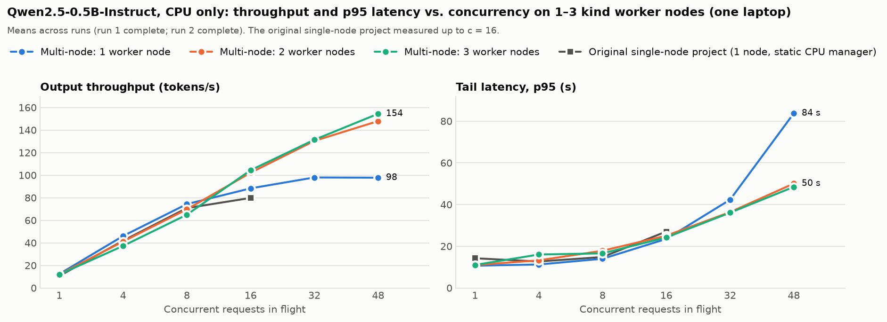
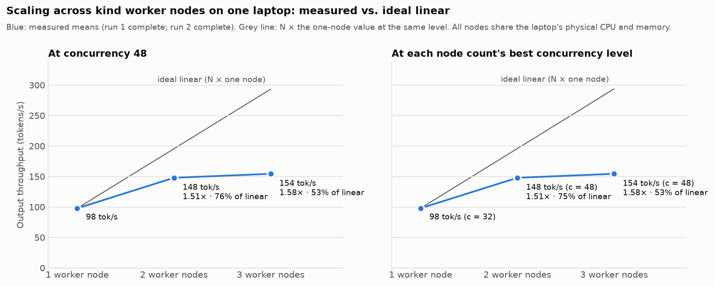
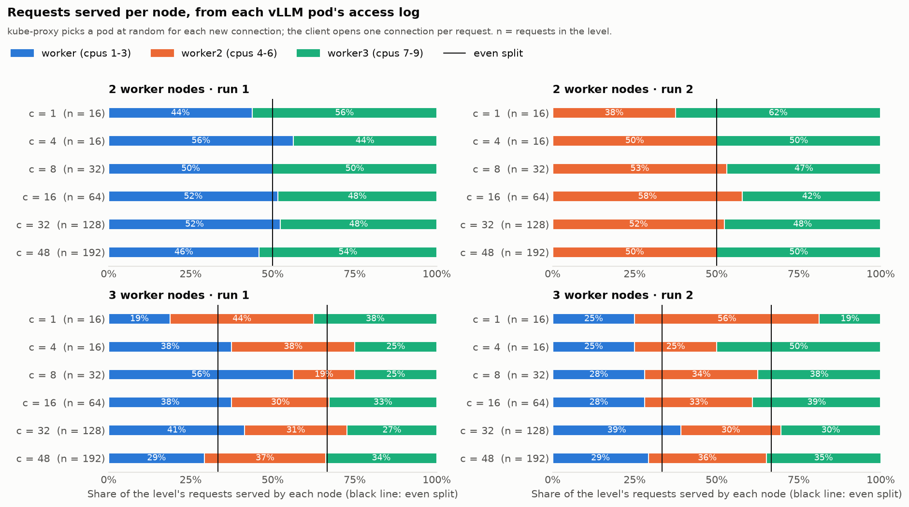
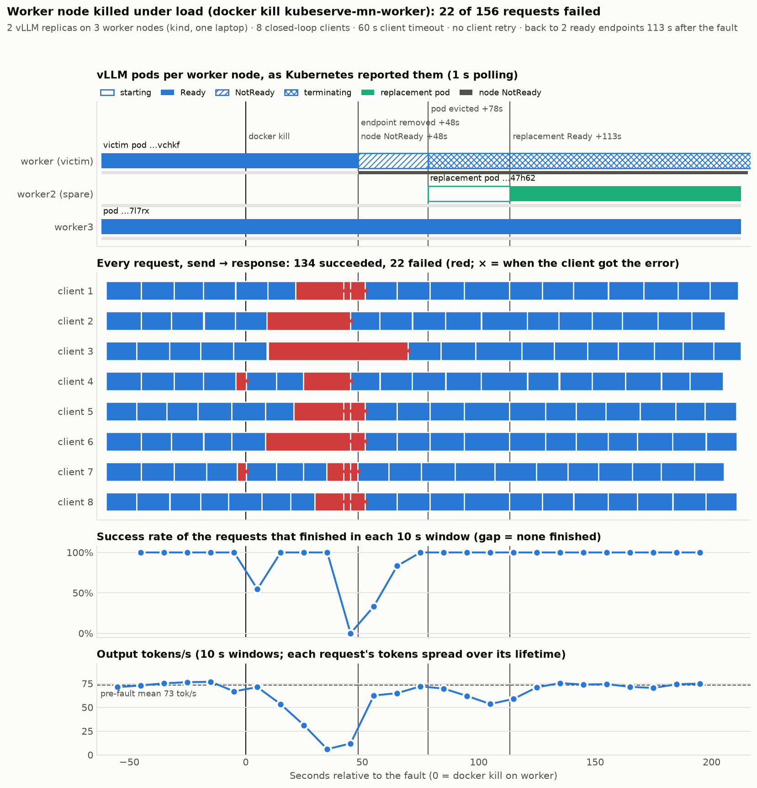
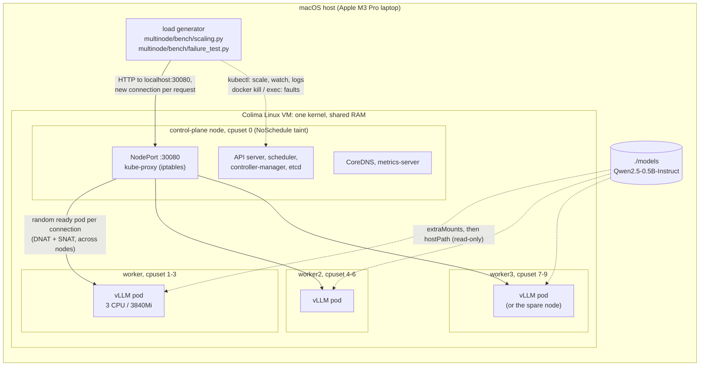

# KubeServe multi-node extension: vLLM across 3 kind worker nodes

This extends the [single-node KubeServe project](../README.md) from one kind node to a kind
cluster with **1 control-plane node and 3 worker nodes**, one vLLM replica per worker. It
asks two questions with the same model, image, pod resources and benchmark method as the
original:

1. **Scaling:** how do throughput and latency change with 1, 2 and 3 replicas, each on its
   own node, behind one Kubernetes Service?
2. **Failure:** what happens to requests in flight, and to new ones, when a worker node or
   the vLLM process in one pod is killed under load? How long does Kubernetes take to
   notice, route around it and replace the lost capacity?

> [!IMPORTANT]
> **Scope: read this before quoting any number.**
> - **One laptop, not a multi-machine cluster.** All four Kubernetes nodes are Docker
>   containers inside **one** Colima Linux VM on **one** Apple M3 Pro laptop. Each node has
>   its own kubelet, container runtime, kube-proxy, IP address and its own pinned set of
>   vCPUs. They still share the laptop's physical CPU cores, memory, memory bandwidth, disk
>   and Linux kernel. This is not multi-machine, multi-region or production, and the
>   scaling numbers describe this laptop, not a real cluster.
> - **CPU only. No GPU was used.** As in the original, vLLM runs on its CPU backend. Every
>   utilisation number is CPU utilisation.
> - **What "node failure" means here:** `docker kill` of a worker node container. That
>   node's kubelet, kube-proxy, pod and network interface disappear at once, and the rest of
>   the cluster has to detect it from missing heartbeats, which is real Kubernetes
>   behaviour. It is **not** a power loss, NIC, switch or network-partition failure between
>   machines: the "network" is a Docker bridge inside the same VM, and the other nodes keep
>   running on the same kernel and hardware.
> - **Small model, laptop numbers.** Qwen2.5-0.5B-Instruct on 3 vCPUs per pod. Absolute
>   throughput is low and noisy. The ratios between setups that share everything except the
>   variable under test are what matter.

<!-- results:start (generated by multinode/bench/report.py; do not edit) -->
## Scaling results

Qwen2.5-0.5B-Instruct, bfloat16, **CPU only**. One vLLM pod per worker node (pod limits: cpu 3, memory 3840Mi); worker containers pinned to their own vCPUs (worker 1-3, worker2 4-6, worker3 7-9); every request generates exactly 128 tokens. Means across runs; full tables in [`results/results.md`](results/results.md).

**Data status (generated):**

- Run 1 (`scaling-run1.json`, node counts in the order 1, 2, 3): complete; 18 of 18 levels measured (1 node at c = 1, 4, 8, 16, 32, 48; 2 nodes at c = 1, 4, 8, 16, 32, 48; 3 nodes at c = 1, 4, 8, 16, 32, 48); 2 rejected attempt(s).
- Run 2 (`scaling-run2.json`, node counts in the order 3, 2, 1): complete; 18 of 18 levels measured (3 nodes at c = 1, 4, 8, 16, 32, 48; 2 nodes at c = 1, 4, 8, 16, 32, 48; 1 node at c = 1, 4, 8, 16, 32, 48); 2 rejected attempt(s).

- **At concurrency 48** (the highest concurrency in the sweep, measured for every node count), one node delivered 97.7 output tok/s; 2 nodes: 147.9 tok/s, 1.51× (efficiency 76%); 3 nodes: 154.4 tok/s, 1.58× (efficiency 53%). Linear scaling would be 100%.
- **Best level per node count** (complete sweeps only): 1 node 97.9 tok/s at c = 32; 2 nodes 147.9 tok/s at c = 48; 3 nodes 154.4 tok/s at c = 48.
- **One node vs. the original single-node project at c = 16:** 88.3 vs. 79.8 tok/s (1.11×). Same image, model and pod resources, but the CPU isolation and VM differ (see [differences](#differences-from-the-single-node-setup)), so this is a sanity check, not a controlled comparison.
- **Requests spread across nodes** (from the pods' access logs): the largest deviation from an even split was 22.9 percentage points (3 nodes, c = 8, run 1, 32 requests); 1 of 24 levels had a chi-square p < 0.05 (about 1.2 expected by chance).
- **Failed requests in the scaling sweeps:** 0 of 2688. **Rejected attempts** (host slept / swapped / pods changed): 4. Largest host swap-out during an accepted level: 33.8 MiB (limit 64 MiB).

**Single-node original vs. multi-node** (output tokens/s and latency, means):

| Concurrency | Original single-node tok/s | 1 node tok/s | 2 nodes tok/s | 3 nodes tok/s | Original p50 / p95 (s) | 1 node p50 / p95 (s) | 2 nodes p50 / p95 (s) | 3 nodes p50 / p95 (s) |
|---:|---:|---:|---:|---:|---:|---:|---:|---:|
| 1 | 10.6 | 12.4 (12.3–12.4) | 11.9 (11.6–12.3) | 11.9 (11.7–12.1) | 11.7 / 14.2 | 10.3 / 10.7 | 10.7 / 11.0 | 10.7 / 11.0 |
| 4 | 41.9 | 46.0 (45.8–46.3) | 41.1 (40.4–41.9) | 37.3 (35.9–38.6) | 12.2 / 12.7 | 11.1 / 11.2 | 12.3 / 13.2 | 13.1 / 16.0 |
| 8 | 70.8 | 74.3 (72.8–75.8) | 69.7 (67.1–72.2) | 64.9 (64.8–65.0) | 14.4 / 14.8 | 13.7 / 14.0 | 13.6 / 17.8 | 15.3 / 16.6 |
| 16 | 79.8 | 88.3 (87.5–89.1) | 102.1 (98.2–106.1) | 104.4 (95.8–112.9) | 25.7 / 27.1 | 23.2 / 23.5 | 18.0 / 25.1 | 18.5 / 24.2 |

**Scaling across nodes:**

| Nodes | tok/s at c = 48 | Speed-up vs. 1 node | Scaling efficiency | Best tok/s (at c) | Speed-up | Efficiency | Levels measured |
|---:|---:|---:|---:|---:|---:|---:|---|
| 1 | 97.7 | 1.00× | 100% | 97.9 (c = 32) | 1.00× | 100% | 1, 4, 8, 16, 32, 48 |
| 2 | 147.9 | 1.51× | 76% | 147.9 (c = 48) | 1.51× | 75% | 1, 4, 8, 16, 32, 48 |
| 3 | 154.4 | 1.58× | 53% | 154.4 (c = 48) | 1.58× | 53% | 1, 4, 8, 16, 32, 48 |







<!-- results:end -->

<!-- failure:start (generated by multinode/bench/report.py; do not edit) -->
## Failure test results

Generated from `summary.json` in each run's directory. Times are seconds after the fault, as first seen by a 1 s watcher (upper bounds). Requests are counted in the phase in which they were sent. Full tables: [`results/results.md`](results/results.md#failure-tests).

| | [`node-kill`](results/failure/node-kill/summary.md) | [`process-crash`](results/failure/process-crash/summary.md) | [`node-kill-retry`](results/failure/node-kill-retry/summary.md) |
|---|---:|---:|---:|
| Valid run | yes | yes | yes |
| Load | 2 replicas, 8 clients | 2 replicas, 8 clients | 2 replicas, 8 clients |
| Victim node Ready ≠ True (s) | 48.2 | n/a | 45.2 |
| Victim pod out of the Service's ready endpoints (s) | 48.2 | 2.1 | 45.2 |
| Victim pod evicted (deletionTimestamp) (s) | 78.3 | not seen | 75.2 |
| Victim container restarted (s) | n/a | 2.1 | n/a |
| Replacement pod Ready (s) | 113.4 | n/a | 106.3 |
| Restarted pod Ready again (s) | n/a | 33.1 | n/a |
| Recovered: R ready endpoints again (s) | 113.4 | 33.1 | 106.3 |
| Requests failed / sent | **22** / 156 | **7** / 115 | **5** / 141 |
| … in flight at the fault / sent after it | 2 / 20 | 5 / 2 | 0 / 5 |
| Errors | RemoteProtocolError 21, ReadTimeout 1 | RemoteProtocolError 7 | RemoteProtocolError 5 |
| Success rate / tok/s, sent before the fault (incl. requests killed in flight) | 95% / 73 | 88% / 70 | 100% / 67 |
| Success rate / tok/s, detection window | 38% / 35 | 71% / 68 | 77% / 47 |
| Success rate / tok/s, degraded | 100% / 63 | 100% / 68 | 100% / 68 |
| Success rate / tok/s, post-recovery | 100% / 73 | 100% / 76 | 100% / 73 |
| Client retry: retried / masked | no retry | no retry | 15 / 10 |



<!-- failure:end -->

<!-- findings:start (generated by multinode/bench/report.py; do not edit) -->
## What the results show

**Scaling (two complete runs; means):**

- **Below saturation, extra nodes did not help.** At concurrency ≤ 8, 2 and 3 nodes delivered 0.81–0.97× the one-node throughput. At that load one replica batches as well as two would, so splitting it gains nothing, and the replicas then compete for the same laptop CPU.
- **One node saturates** at about 97.9 tok/s (c = 32); from there, more concurrency only adds queueing.
- **At concurrency 48**, one node delivered 97.7 tok/s; 2 nodes: 147.9 tok/s (1.51×); 3 nodes: 154.4 tok/s (1.58×). The third node added only 4% over two.
- **Tail latency improves with nodes under heavy load:** p95 at concurrency 48 was 84 s with 1 node, 50 s with 2 nodes, 48 s with 3 nodes.
- **Why the curve flattens:** each node has its own 3 vCPUs inside the VM, but all of them are threads on one laptop CPU (performance + efficiency cores) with one memory bus, shared with macOS. Adding a node adds a scheduling domain, not hardware.

**Failures (each scenario run once, under load: 2 replicas, 8 clients, 60 s client timeout):**

- **Worker node killed:** 22 of 156 requests failed. 2 were in flight on the killed node; 20 were sent during the 48 s before Kubernetes marked the node NotReady and took its pod out of the Service. In that window only 38% of requests succeeded and throughput fell to 35 tok/s (from 73): requests routed to the dead pod hung until they failed, so the healthy replica was underused. After that, every request succeeded on the surviving replica (63 tok/s) until the replacement, created on the spare node at 78 s, was Ready at 113 s.
- **vLLM process crashed:** detected in 2 s (the node's kubelet saw the container exit and marked the pod not Ready), so only 7 of 115 requests failed, 5 of them in flight on that pod. The container restarted in place and the pod was back in the Service after 33 s (model reload).
- **Node killed, client retries once:** 5 of 141 requests failed. 15 requests were retried; 10 succeeded on the retry and 5 failed again: a retry is just another new connection, and until the node is detected it can land on the dead pod again. Rescued requests lost up to 39 s.
- **The difference is detection:** a crashed process is seen by its own node's kubelet within seconds; a dead node is only noticed when its heartbeats stop arriving (kube-controller-manager's node-monitor grace period), and until then kube-proxy keeps sending new connections to it.

<!-- findings:end -->

## What is genuinely multi-node here, and what is not

| Aspect | Genuinely multi-node | Not multi-node, because it is one laptop |
|---|---|---|
| Kubernetes objects and scheduling | 4 separate `Node` objects. The scheduler places pods by `nodeSelector` and a **required** pod anti-affinity (at most one vLLM pod per node) | One control-plane node: no HA control plane |
| Node agents | Each node runs its own kubelet, containerd and kube-proxy, and sends its own heartbeats (node lease). Killing a node stops exactly those | All nodes are processes on the same VM kernel |
| Failure detection and recovery | Real node-lifecycle controller behaviour: NotReady after missed heartbeats, `unreachable` taint, eviction after the pod's toleration, ReplicaSet replacement on another node, endpoint removal | The fault is `docker kill`. There are no partial failures (packet loss, slow disk, half-open links) |
| Networking | Each node has its own IP. Traffic enters on the control-plane's NodePort, and kube-proxy forwards each new connection to a pod on one of the **worker** nodes (kindnet routes it across nodes; the source is SNATed) | The "network" is a Docker bridge in one VM: no physical NIC, switch or real latency |
| Load balancing | Real kube-proxy (iptables mode): a random ready endpoint per new connection. Who served what is counted from each pod's access log | One ingress node, which is also a single point of failure. Production would use a load balancer in front of many nodes |
| CPU | Each node container is pinned to its own vCPUs (`docker update --cpuset-cpus`), so pods never share a vCPU | Every vCPU is a thread on the same laptop CPU. macOS decides which physical (performance or efficiency) core runs it, and the nodes compete for cores, caches and memory bandwidth |
| Memory | Each pod has its own cgroup limit (Guaranteed QoS) | No per-node memory limit: all nodes share the VM's RAM, and the VM shares the Mac's RAM. The kubelet on every node reports the whole VM as its capacity |
| Storage | Each worker mounts the model directory | It is the same host directory (kind `extraMounts`), not a disk per node |
| Inference | Independent replicas behind one Service (data-parallel serving) | No tensor or pipeline parallelism: one request is always served by one pod on one node |

## Architecture



The values in the diagram are configuration, quoted from the files that set them: cpusets
from [`scripts/pin-node-cpus.sh`](scripts/pin-node-cpus.sh), pod resources from
[`k8s/vllm/deployment.yaml`](k8s/vllm/deployment.yaml), the NodePort from
[`k8s/vllm/service.yaml`](k8s/vllm/service.yaml). The values that were actually in effect
during each run (`docker inspect` of every node, the Deployment and Service as the API
server returned them) are recorded in the raw JSON and printed in the generated
[setup section](results/results.md#setup).

| Piece | What it is |
|---|---|
| [`cluster/kind-multinode.yaml.tpl`](cluster/kind-multinode.yaml.tpl) | kind config: 1 control-plane (keeps its NoSchedule taint, maps host port 30080) + 3 workers labelled `kubeserve.io/role=inference`, each mounting `./models`. CPU manager left at `none` (why: [differences](#differences-from-the-single-node-setup)) |
| [`scripts/cluster-up.sh`](scripts/cluster-up.sh) | creates the cluster, pins the node CPUs, keeps CoreDNS and metrics-server on the control-plane, loads the image into the workers, deploys vLLM and prints node, cpuset and pods |
| [`scripts/pin-node-cpus.sh`](scripts/pin-node-cpus.sh) | `docker update --cpuset-cpus` per node container, verified from inside each node; re-run after a node restart |
| [`k8s/vllm/`](k8s/vllm/) | Deployment (one replica per inference worker, 30 s eviction tolerations) and NodePort Service. No HPA |
| [`k8s/metrics-server/`](k8s/metrics-server/) | the root project's metrics-server, pinned to the control-plane |
| [`bench/scaling.py`](bench/scaling.py) | scaling sweep; asserts the topology before measuring. Helpers: [`cluster.py`](bench/cluster.py) (kubectl, placement, cpusets), [`accesslog.py`](bench/accesslog.py) (per-pod request counts), [`hostguard.py`](bench/hostguard.py) (host swap guard) |
| [`bench/failure_test.py`](bench/failure_test.py) | node-kill and process-crash fault injection under load, with a 1 s cluster watcher and per-request classification |
| [`bench/report.py`](bench/report.py), [`bench/report_charts.py`](bench/report_charts.py) | turns the raw files into [`results/results.md`](results/results.md), [`results/results.json`](results/results.json), the charts and the generated blocks of this README |
| [`results/`](results/) | everything the scripts produced: `raw/` (scaling runs with every request), `failure/<scenario>/` (summaries, timelines, pod logs, events) |

## Methodology

The load and measurement are the original project's, unchanged
([root README, benchmark methodology](../README.md#benchmark-methodology)): the same load
generator (`bench/loadgen.py`), closed loop with *c* workers, N = max(16, 4·*c*) requests
per level, exactly 128 output tokens per request (`ignore_eos`, greedy), warm-up requests
before measuring, a new TCP connection per request, p50/p95 by linear interpolation, CPU from the
pods' cgroups, and the host-sleep check. What the multi-node sweep adds:

- **Concurrency levels 32 and 48** on top of the original 1, 4, 8, 16, so that three
  replicas get enough concurrent requests to batch.
- **Each replica count is its own experiment.** The harness scales the Deployment to R,
  then asserts the topology before measuring anything: exactly R pods, all Ready, none
  terminating, on R distinct worker nodes, with non-overlapping cpusets (read from each
  pod's cgroup), and the Service's ready endpoints are exactly those pods. Every pod gets
  warm-up traffic first. If a pod restarts or disappears during a level, the run aborts
  rather than recording a mislabelled number.
- **Who served what.** The client only sees the Service, so each pod's access log is
  counted before and after every level. The per-pod counts must add up to the client's
  successful requests (`served_check`). The report tests the split against an even one.
- **Host swap guard.** The nodes share the Mac's RAM, so a level during which macOS
  swapped out more than the limit recorded in each run's `workload.host_swap_limit_mib`
  is rejected and re-run, exactly like a level during which the laptop slept.
  Rejected attempts are kept in the raw JSON and listed in the report.
- **Two repeats with the replica order reversed**, run one after the other (run 1: 1, 2, 3
  nodes; then the failure tests; then run 2: 3, 2, 1), so slow drift (thermal state,
  background load) does not line up with the node count. Tables show the mean and the
  min–max across runs.
- **Scaling efficiency** = tok/s with R nodes ÷ (R × tok/s with 1 node) at the same
  concurrency. At low concurrency, extra nodes cannot help (one request is served by one
  pod), so the meaningful comparison is at high concurrency.

**Failure tests** ([`bench/failure_test.py`](bench/failure_test.py); the parameters of
each run are recorded in its `summary.json` and printed in the generated block). The
Deployment is scaled to the test's replica count, leaving a spare worker for the
replacement pod in the node-kill test. A closed-loop load runs with a client timeout,
and a watcher records every change of the nodes, pods and EndpointSlices once per second.
After a steady pre-fault period the fault is injected:

- **node-kill:** `docker kill` of the worker that hosts the victim pod (guarded in code:
  only the three worker containers can be targeted, never the control-plane).
- **process-crash:** `SIGKILL` of the `vllm serve` process inside the victim pod, sent
  from its node. The pod object survives, and the kubelet restarts the container in place.

The load continues until Kubernetes has recovered (R ready endpoints again) and for a
fixed period after that. Then the cluster is restored (`docker start` + CPU re-pinning).
Every request is classified as succeeded, failed while in flight at the fault, or failed
after being sent after the fault. Each phase (pre-fault, detection, degraded,
post-recovery) gets its own success rate and throughput. A separate **retry** run repeats
node-kill with a client that retries a failed request once, to show how much a simple
retry hides.

**Which Kubernetes timers set the node-kill timeline.** None of them is changed in this
cluster: the kind config has no `kubeadmConfigPatches`, so the upstream defaults of
Kubernetes v1.37 apply. The node controller marks a node `NotReady`/`Unknown` once it
has not heard from the kubelet for `--node-monitor-grace-period` (kube-controller-manager
default 50 s) and adds the `node.kubernetes.io/unreachable:NoExecute` taint. The vLLM
pods tolerate that taint for 30 s (`tolerationSeconds` in
[`deployment.yaml`](k8s/vllm/deployment.yaml), shorter than the 300 s Kubernetes adds by
default) before they are evicted and the ReplicaSet creates a replacement. Until the node
is marked NotReady, the dead pod stays a *ready* endpoint, so kube-proxy keeps sending
about 1/R of new connections to it, and those requests cannot succeed. As
[what the results show](#what-the-results-show) reports, that window produced most of the
failed requests in the node-kill test. After a process crash, by contrast, the kubelet on
the same node sees the container exit straight away.

**Limitations of these measurements.**
- **Each failure scenario was run once** (one fault injection per scenario). Detection time
  depends on where the kill lands in the kubelet's 10 s status cycle and the controller's 5 s
  check, so a repeat would give somewhat different seconds; the failure counts depend on how
  many clients happened to be routed to the victim.
- **The 1-node reference was the same pod on `worker3`** in both scaling runs; the 2- and
  3-node levels used different pods and nodes.
- **16–192 requests per level**, so p95 at the low levels rests on few samples. Non-streaming
  requests only (no time-to-first-token), one prompt and output length, and the load
  generator runs on the same laptop.
- `events.txt` in the failure directories also shows two **earlier dry runs without load**
  (about 23:00 UTC), used to check node-kill and restore before the measured runs. None of
  their data is used.

## How to reproduce

Needs the same tools as the root project (Colima, Docker, kind, kubectl, uv), the model in
`./models` (`make model` in the repo root) and ~13 GiB for the VM. The single-node
cluster must be deleted first (`make down` in the repo root), because both clusters use
host port 30080; `cluster-up.sh` checks this.

```bash
make -C multinode help      # list the targets
make -C multinode vm        # Colima VM with 10 vCPU / 13 GiB (the cpuset layout needs 10 CPUs)
make -C multinode cluster   # kind cluster kubeserve-mn, CPU pinning, vLLM (1 replica)

make -C multinode scaling   # run 1 (1,2,3 nodes) then run 2 (3,2,1), then the report
make -C multinode failure   # node-kill, process-crash, node-kill --retry, then the report
make -C multinode report    # rebuild results.{md,json}, charts and the README blocks

make -C multinode down      # delete the multi-node cluster
```

Each run and report target `cd`s to the repo root, so `make` also works from inside `multinode/`.
`scaling-run1` / `scaling-run2` and `failure-node-kill` / `failure-process-crash` /
`failure-node-kill-retry` run a single step. A scaling target refuses to overwrite an
existing `scaling-runN.json`. Long runs use `caffeinate -is`: keep the Mac on AC power.
The report can be re-run at any time, also while a sweep is still writing its JSON.
It then labels the results as partial.

## Differences from the single-node setup

| | Single-node project (repo root) | Multi-node extension | Why |
|---|---|---|---|
| Nodes | 1 kind node: control plane and workloads in one container | 1 control-plane (tainted; ingress, CoreDNS, metrics-server) + 3 workers that run only vLLM and the per-node DaemonSets (recorded in [`results/cluster_state.txt`](results/cluster_state.txt)) | the point of the extension |
| VM | `VM_CPUS ?= 9`, `VM_MEMORY ?= 9` ([root `Makefile`](../Makefile)) | `VM_CPUS ?= 10`, `VM_MEMORY ?= 13` ([`Makefile`](Makefile)) | 3 workers × 3 vCPUs + 1 for the control-plane, and memory for 3 replicas |
| CPU isolation | kubelet **static CPU manager** (`cpuManagerPolicy: static`, `reservedSystemCPUs: "0"` in [`cluster/kind-config.yaml.tpl`](../cluster/kind-config.yaml.tpl)): the pod gets exclusive cores, and system daemons stay on CPU 0 | **Docker cpuset per node container** ([`pin-node-cpus.sh`](scripts/pin-node-cpus.sh)), CPU manager `none`. The node's own daemons (kubelet, containerd, kube-proxy, kindnet) share the node's 3 vCPUs with the pod | the static policy hands out CPUs from the kubelet's view of the machine (all VM CPUs), which lie outside a node's pinned cpuset ([`kind-multinode.yaml.tpl`](cluster/kind-multinode.yaml.tpl)) |
| vLLM threads | `VLLM_ENABLE_V1_MULTIPROCESSING=0` (model worker inside the engine-core process): vLLM's OpenMP binding is not applied, so torch runs one thread per VM CPU on the pod's 3 cores | the same, with one more VM CPU (comment in [`deployment.yaml`](k8s/vllm/deployment.yaml)) | unchanged engine configuration |
| vLLM container | image, args and resources as in [`k8s/vllm/deployment.yaml`](../k8s/vllm/deployment.yaml) | the same, plus `TORCH_COMPILE_DISABLE=1` | a sampled (non-greedy) request made vLLM's CPU sampler compile a kernel at runtime, and the compile step OOM-killed the pod. Benchmark requests are greedy and never reach that path, so the measured path is unchanged |
| Rollout strategy | `maxSurge: 1`, `maxUnavailable: 0` | `maxSurge: 0`, `maxUnavailable: 1` | with one pod per node and every worker busy, a surge pod could never be scheduled |
| Placement | one node | `nodeSelector: kubeserve.io/role=inference` + required pod anti-affinity on `kubernetes.io/hostname` | one replica per worker, never two on one node |
| Node-failure tolerations | Kubernetes default (300 s) | `tolerationSeconds: 30` for `unreachable` and `not-ready` | the failure test measures eviction and replacement; 300 s would mostly measure waiting |
| Autoscaling | HPA on CPU (1–2 replicas) | none: the harness sets the replica count | a scaling curve needs fixed, known replica counts |
| Traffic path | NodePort on the only node | NodePort on the control-plane only, `externalTrafficPolicy: Cluster`: each connection is forwarded to a pod on a worker (SNAT) | the ingress node runs no vLLM pod |
| Baseline | FastAPI + `transformers` comparison | not repeated | this extension compares vLLM against itself at 1, 2 and 3 nodes |
| Benchmark additions | sleep guard | + concurrency 32/48, topology assertions, per-pod access-log counts, host swap guard | see [methodology](#methodology) |

Because of the first four rows, the 1-node multi-node numbers are not expected to equal the
original's. The generated comparison table puts them side by side as a consistency check;
it is not a controlled experiment on any one of these differences.

## How this differs from production

| | This extension | A production deployment |
|---|---|---|
| Machines | 4 containers in one VM on one laptop: one kernel, one CPU, one RAM pool | separate machines or VMs, often across availability zones, each with its own CPU, memory, NIC and power |
| Accelerators | CPU only | GPUs, with vLLM's CUDA kernels |
| Failure domains | a "node failure" is `docker kill` of a container | power, kernel, NIC, top-of-rack switch, zone outages, network partitions, gray failures (slow but alive) |
| Control plane | one control-plane node, which is also the only ingress | 3+ control-plane nodes (often managed), separate from the ingress |
| Ingress and balancing | one NodePort, L4: a random pod per **connection**; requests to a dead pod fail until Kubernetes removes its endpoint | a load balancer or Gateway across many nodes, with active health checks and outlier detection that eject a failing endpoint in seconds; L7, per-request routing for LLMs (e.g. least outstanding requests, KV-cache-aware routing via the Gateway API Inference Extension) |
| Failure detection | upstream defaults (node grace period); no client retries except in the dedicated retry run | tuned node-monitor and toleration settings, readiness plus proxy-level outlier detection, client retries with budgets and idempotency, PodDisruptionBudgets for planned work |
| Spare capacity | one idle worker for the replacement pod | cluster autoscaler or over-provisioning, sized so that losing a node or a zone does not overload the rest |
| Model storage | one host directory mounted into every node | per-node cache from object storage or a PVC, or weights in the image |
| Observability | scripts reading cgroups, access logs and `kubectl` | Prometheus, vLLM's `/metrics`, dashboards, alerts, tracing |
