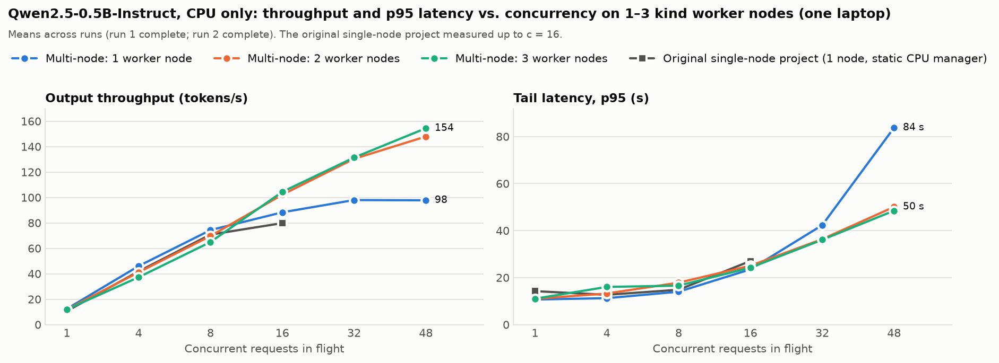
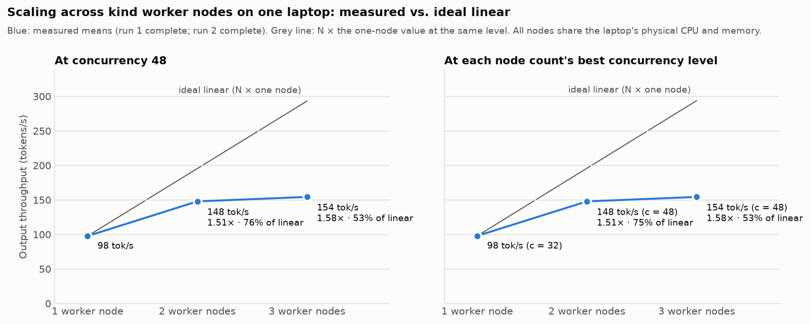
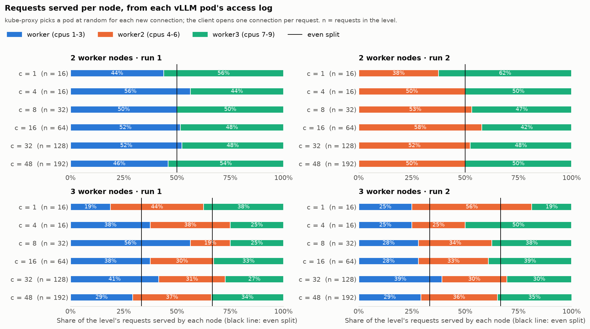
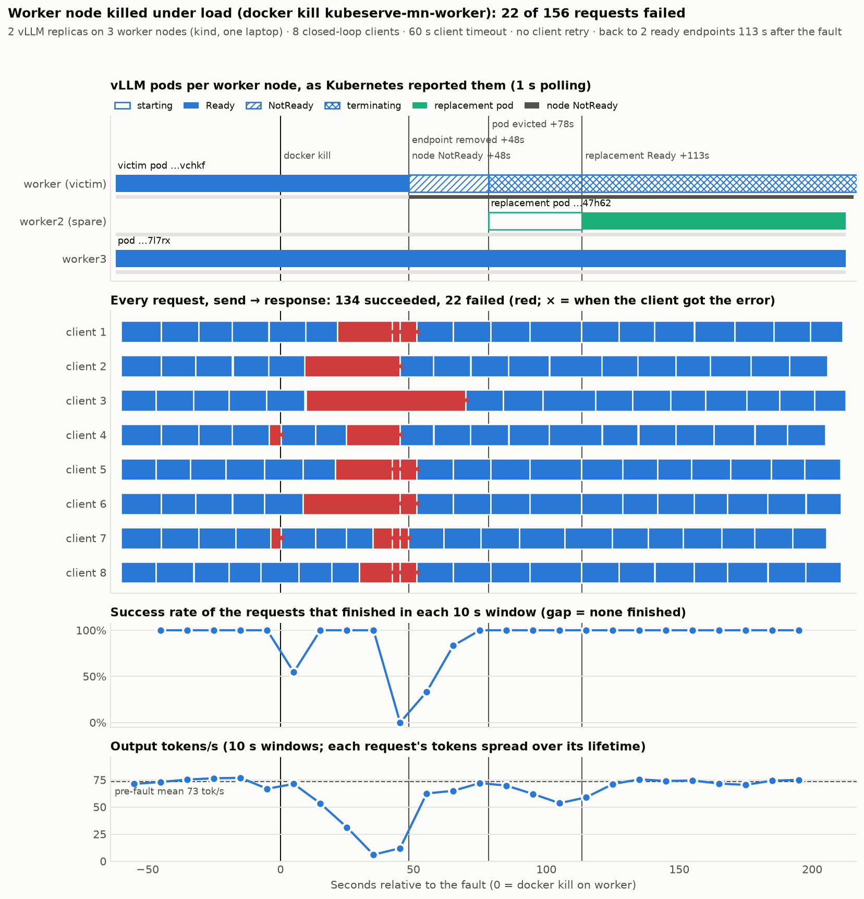
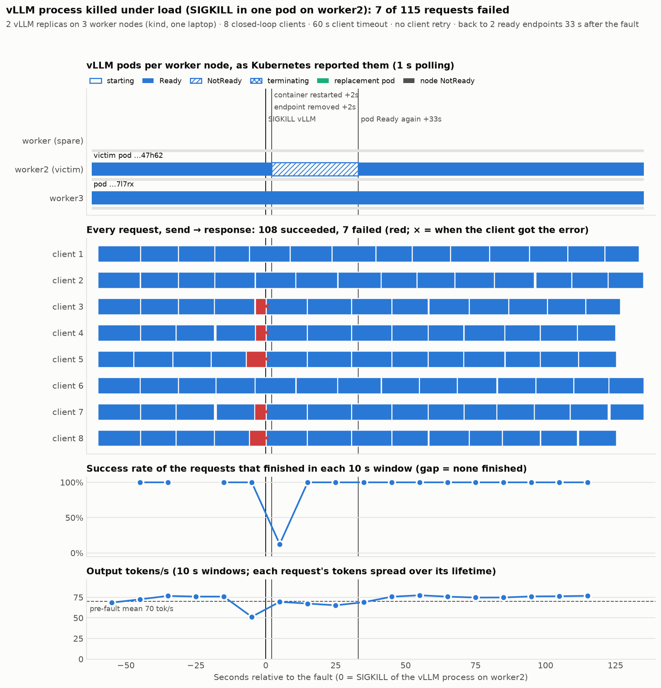
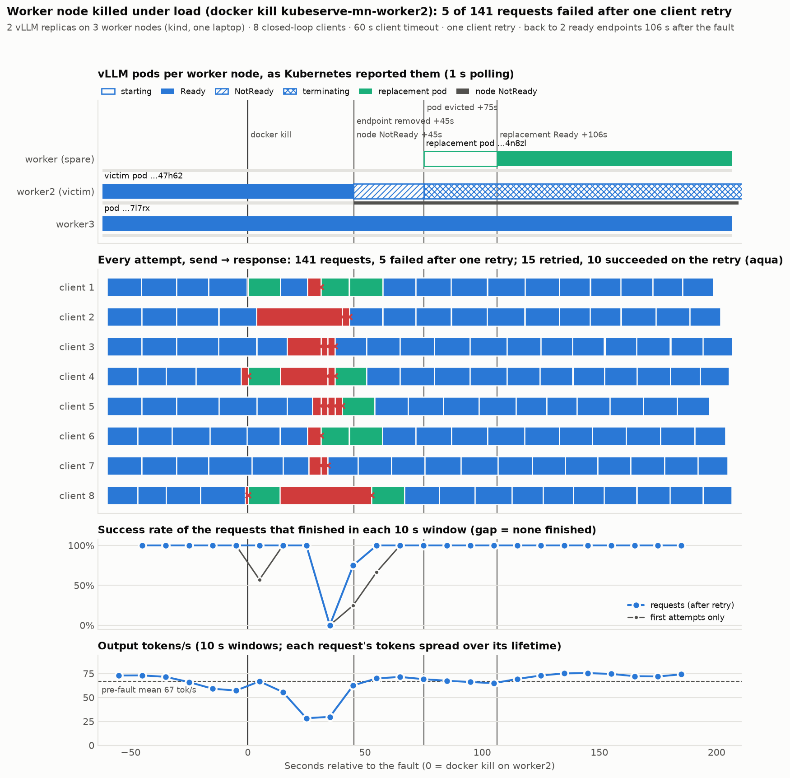

# Multi-node scaling results: vLLM on 1, 2 and 3 kind worker nodes

_Generated 2026-11-03T01:11:27+00:00 by `multinode/bench/report.py` from `multinode/results/raw/scaling-run*.json`, `results/results.json` and `multinode/results/failure/*/summary.json`. Do not edit by hand._

> All nodes are containers in one VM on one laptop (CPU only, no GPU). They have separate kubelets, IPs and CPU sets, but share the laptop's physical CPU, memory and memory bandwidth. See [`../README.md`](../README.md) for the scope.

## Data status

- Run 1 (`scaling-run1.json`, node counts in the order 1, 2, 3): complete; 18 of 18 levels measured (1 node at c = 1, 4, 8, 16, 32, 48; 2 nodes at c = 1, 4, 8, 16, 32, 48; 3 nodes at c = 1, 4, 8, 16, 32, 48); 2 rejected attempt(s).
- Run 2 (`scaling-run2.json`, node counts in the order 3, 2, 1): complete; 18 of 18 levels measured (3 nodes at c = 1, 4, 8, 16, 32, 48; 2 nodes at c = 1, 4, 8, 16, 32, 48; 1 node at c = 1, 4, 8, 16, 32, 48); 2 rejected attempt(s).

## Setup

- **Model:** Qwen/Qwen2.5-0.5B-Instruct (bfloat16); **accelerator:** none -- CPU only (no GPU was used)
- **Host:** Apple M3 Pro, Darwin 27.0.0, 11 logical CPUs, 18.0 GiB RAM
- **Docker VM (Colima), which holds every node:** 10 vCPUs, 12.64 GiB (`docker info`)
- **Cluster:** `kind-kubeserve-mn`, 4 kind nodes (3 workers), Kubernetes v1.37.0, kube-proxy mode `iptables`
- **vLLM Deployment:** image `kubeserve-vllm:v1`, requests cpu 3, memory 3840Mi, limits cpu 3, memory 3840Mi (QoS Guaranteed when they are equal), node selector `{"kubeserve.io/role": "inference"}`, strategy `{"rollingUpdate": {"maxSurge": 0, "maxUnavailable": 1}, "type": "RollingUpdate"}`
- **vLLM args:** `/models/Qwen2.5-0.5B-Instruct --served-model-name=qwen2.5-0.5b-instruct --host=0.0.0.0 --port=8000 --dtype=bfloat16 --max-model-len=2048 --max-num-seqs=32 --kv-cache-memory-bytes=268435456 --enforce-eager --generation-config=vllm --shutdown-timeout=60`
- **vLLM env:** `VLLM_CPU_OMP_THREADS_BIND=auto`, `TORCH_COMPILE_DISABLE=1`
- **Service:** `NodePort`, externalTrafficPolicy `Cluster`, sessionAffinity `None`, port 8000 → target `http`, nodePort 30080

| Node | Role | Docker cpuset (`docker inspect`) | CPUs in the cpuset | Capacity the kubelet reports (cpu / memory) |
|---|---|---|---:|---|
| `kubeserve-mn-control-plane` | control-plane | 0 | 1 | 10 / 13250740Ki |
| `kubeserve-mn-worker` | worker | 1-3 | 3 | 10 / 13250740Ki |
| `kubeserve-mn-worker2` | worker | 4-6 | 3 | 10 / 13250740Ki |
| `kubeserve-mn-worker3` | worker | 7-9 | 3 | 10 / 13250740Ki |

Every node reports the whole VM as its capacity because kind nodes are containers; the Docker cpuset is what a node can actually run on. The required pod anti-affinity in the Deployment allows one vLLM pod per node.

| | Original single-node project | Multi-node (this extension) |
|---|---|---|
| Kubernetes nodes | 1 | 4 (3 workers + control-plane) |
| VM CPUs (kubelet capacity) | 9 | 10 |
| vLLM pod limits | cpu 3, memory 3840Mi | cpu 3, memory 3840Mi |
| vLLM sweeps used | 2 | 2 |

### Replica placement per run

| Run | Nodes | Pod → node (cpuset) | cpusets disjoint | QoS | Scale → ready + endpoints (s) | Warm-up requests (failed) | Pods still cold after warm-up |
|---:|---:|---|---|---|---:|---:|---|
| 1 | 1 | `vllm-5b6f494778-7l7rx` → worker3 (7-9) | True | Guaranteed | 0.2 | 2 (0) | none |
| 1 | 2 | `vllm-5b6f494778-vchkf` → worker (1-3); `vllm-5b6f494778-7l7rx` → worker3 (7-9) | True | Guaranteed | 30.9 | 10 (0) | none |
| 1 | 3 | `vllm-5b6f494778-vchkf` → worker (1-3); `vllm-5b6f494778-l55vl` → worker2 (4-6); `vllm-5b6f494778-7l7rx` → worker3 (7-9) | True | Guaranteed | 31.0 | 6 (0) | none |
| 2 | 3 | `vllm-5b6f494778-4n8zl` → worker (1-3); `vllm-5b6f494778-8nkqs` → worker2 (4-6); `vllm-5b6f494778-7l7rx` → worker3 (7-9) | True | Guaranteed | 30.9 | 6 (0) | none |
| 2 | 2 | `vllm-5b6f494778-8nkqs` → worker2 (4-6); `vllm-5b6f494778-7l7rx` → worker3 (7-9) | True | Guaranteed | 15.7 | 4 (0) | none |
| 2 | 1 | `vllm-5b6f494778-7l7rx` → worker3 (7-9) | True | Guaranteed | 15.6 | 2 (0) | none |

## Methodology

- **Pattern:** closed loop: c workers, each sends its next request as soon as the previous returns; keep-alive False (a new TCP connection per request, so kube-proxy picks a pod for every request)
- **Levels:** concurrency 1, 4, 8, 16, 32, 48 for each node count 1, 2, 3; requests per level: c=1: 16, c=4: 16, c=8: 32, c=16: 64, c=32: 128, c=48: 192
- **Requests:** exactly 128 output tokens (ignore_eos=True), temperature 0.0 (greedy)
- **Warm-up:** after each scale: 2R requests at concurrency R, topped up until every pod has served >= 2; not recorded
- **Pause between levels:** 5.0 s; up to 5 attempts per level
- **Validity guards:** an attempt is rejected and re-run if the host slept more than 5.0 s or macOS swapped out more than 64.0 MiB during it; if the vLLM pods changed during a level, the attempt is recorded as rejected and the whole run aborts (this never happened)
- **Repeats (sequential, not interleaved):** run 1: node counts in the order 1, 2, 3; run 2: node counts in the order 3, 2, 1. Tables show the mean across runs; the min–max across runs is in parentheses where runs differ
- **Throughput** = successful requests (or output tokens) ÷ wall time from first send to last response; **latency** is end-to-end per request including time queued in the server; p50/p95 by linear interpolation
- **CPU** from each pod's cgroup `cpu.stat`, sampled by `RobustPodStatsSampler` (multinode/bench/cluster.py; the original's sampler with retries); node daemons (kubelet, kube-proxy, kindnet) run in the same node cpuset but outside the pod cgroup, so they are not counted
- **Scaling efficiency** = tok/s with R nodes ÷ (R × tok/s with 1 node) at the same concurrency, from the means. At low concurrency extra nodes cannot help (one request runs on one pod), so efficiency there is low by construction
- vLLM runs with `--max-num-seqs=32`: beyond 32 requests in flight per pod, the rest queue inside that pod

## Single-node original vs. multi-node (shared concurrency levels)

The original column is the single-node project's vLLM (2 sweeps, 1 node, static CPU manager). Means, with the min–max across runs in parentheses.

| Concurrency | Original single-node tok/s | 1 node tok/s | 2 nodes tok/s | 3 nodes tok/s | Original p50 / p95 (s) | 1 node p50 / p95 (s) | 2 nodes p50 / p95 (s) | 3 nodes p50 / p95 (s) |
|---:|---:|---:|---:|---:|---:|---:|---:|---:|
| 1 | 10.6 | 12.4 (12.3–12.4) | 11.9 (11.6–12.3) | 11.9 (11.7–12.1) | 11.7 / 14.2 | 10.3 / 10.7 | 10.7 / 11.0 | 10.7 / 11.0 |
| 4 | 41.9 | 46.0 (45.8–46.3) | 41.1 (40.4–41.9) | 37.3 (35.9–38.6) | 12.2 / 12.7 | 11.1 / 11.2 | 12.3 / 13.2 | 13.1 / 16.0 |
| 8 | 70.8 | 74.3 (72.8–75.8) | 69.7 (67.1–72.2) | 64.9 (64.8–65.0) | 14.4 / 14.8 | 13.7 / 14.0 | 13.6 / 17.8 | 15.3 / 16.6 |
| 16 | 79.8 | 88.3 (87.5–89.1) | 102.1 (98.2–106.1) | 104.4 (95.8–112.9) | 25.7 / 27.1 | 23.2 / 23.5 | 18.0 / 25.1 | 18.5 / 24.2 |

| Concurrency | 1 node ÷ original (tok/s) | 2 nodes ÷ original (tok/s) | 3 nodes ÷ original (tok/s) |
|---:|---:|---:|---:|
| 1 | 1.16× | 1.13× | 1.12× |
| 4 | 1.10× | 0.98× | 0.89× |
| 8 | 1.05× | 0.98× | 0.92× |
| 16 | 1.11× | 1.28× | 1.31× |

## Full scaling table

| Nodes | Concurrency | Runs | Output tok/s | req/s | p50 (s) | p95 (s) | p99 (s) | Speed-up vs. 1 node | Scaling efficiency | Failed |
|---:|---:|---:|---:|---:|---:|---:|---:|---:|---:|---:|
| 1 | 1 | 2 | 12.4 (12.3–12.4) | 0.097 (0.096–0.097) | 10.3 (10.3–10.4) | 10.7 (10.6–10.7) | 10.7 (10.6–10.8) | 1.00× | 100% | 0 of 32 |
| 1 | 4 | 2 | 46.0 (45.8–46.3) | 0.360 (0.358–0.362) | 11.1 (11.0–11.2) | 11.2 (11.2–11.3) | 11.2 (11.2–11.3) | 1.00× | 100% | 0 of 32 |
| 1 | 8 | 2 | 74.3 (72.8–75.8) | 0.581 (0.569–0.592) | 13.7 (13.5–13.9) | 14.0 (13.6–14.4) | 14.0 (13.6–14.4) | 1.00× | 100% | 0 of 64 |
| 1 | 16 | 2 | 88.3 (87.5–89.1) | 0.690 (0.683–0.696) | 23.2 (22.9–23.4) | 23.5 (23.2–23.8) | 23.5 (23.2–23.8) | 1.00× | 100% | 0 of 128 |
| 1 | 32 | 2 | 97.9 (97.9–98.0) | 0.765 (0.765–0.766) | 41.7 (41.7–41.8) | 42.3 (42.2–42.4) | 42.3 (42.2–42.4) | 1.00× | 100% | 0 of 256 |
| 1 | 48 | 2 | 97.7 (96.9–98.6) | 0.764 (0.757–0.771) | 45.5 (45.1–46.0) | 83.8 (83.2–84.3) | 83.8 (83.2–84.3) | 1.00× | 100% | 0 of 384 |
| 2 | 1 | 2 | 11.9 (11.6–12.3) | 0.093 (0.091–0.096) | 10.7 (10.5–11.0) | 11.0 (10.7–11.3) | 11.0 (10.7–11.3) | 0.97× | 48% | 0 of 32 |
| 2 | 4 | 2 | 41.1 (40.4–41.9) | 0.321 (0.316–0.327) | 12.3 (12.0–12.6) | 13.2 (13.1–13.3) | 13.2 (13.2–13.3) | 0.89× | 45% | 0 of 32 |
| 2 | 8 | 2 | 69.7 (67.1–72.2) | 0.544 (0.525–0.564) | 13.6 (13.4–13.8) | 17.8 (15.2–20.5) | 17.8 (15.2–20.5) | 0.94× | 47% | 0 of 64 |
| 2 | 16 | 2 | 102.1 (98.2–106.1) | 0.798 (0.767–0.829) | 18.0 (17.3–18.6) | 25.1 (24.8–25.3) | 25.1 (25.0–25.3) | 1.16× | 58% | 0 of 128 |
| 2 | 32 | 2 | 130.4 (127.9–132.9) | 1.018 (0.999–1.038) | 28.1 (28.0–28.2) | 36.4 (36.0–36.7) | 36.6 (36.0–37.2) | 1.33× | 67% | 0 of 256 |
| 2 | 48 | 2 | 147.9 (145.4–150.4) | 1.155 (1.136–1.175) | 37.5 (37.1–37.9) | 50.1 (46.8–53.3) | 56.6 (46.9–66.3) | 1.51× | 76% | 0 of 384 |
| 3 | 1 | 2 | 11.9 (11.7–12.1) | 0.093 (0.092–0.095) | 10.7 (10.6–10.9) | 11.0 (10.7–11.3) | 11.1 (10.8–11.3) | 0.97× | 32% | 0 of 32 |
| 3 | 4 | 2 | 37.3 (35.9–38.6) | 0.291 (0.281–0.301) | 13.1 (12.5–13.8) | 16.0 (15.4–16.7) | 16.2 (15.4–17.1) | 0.81× | 27% | 0 of 32 |
| 3 | 8 | 2 | 64.9 (64.8–65.0) | 0.507 (0.506–0.508) | 15.3 (15.1–15.4) | 16.6 (16.2–16.9) | 16.8 (16.4–17.2) | 0.87× | 29% | 0 of 64 |
| 3 | 16 | 2 | 104.4 (95.8–112.9) | 0.815 (0.749–0.882) | 18.5 (17.7–19.3) | 24.2 (20.3–28.1) | 24.6 (20.3–28.9) | 1.18× | 39% | 0 of 128 |
| 3 | 32 | 2 | 131.4 (129.7–133.0) | 1.026 (1.013–1.039) | 30.9 (30.4–31.4) | 36.1 (35.6–36.6) | 36.9 (36.6–37.2) | 1.34× | 45% | 0 of 256 |
| 3 | 48 | 2 | 154.4 (153.6–155.2) | 1.206 (1.200–1.212) | 36.7 (36.5–36.9) | 48.5 (48.1–48.8) | 48.7 (48.6–48.8) | 1.58× | 53% | 0 of 384 |

## Scaling curve

Throughput at the highest concurrency measured for every node count (c = 48) and at each node count's best level. At c = 48, efficiency is relative to one node at c = 48; in the best-level columns it is relative to one node's best level (100% = linear).

| Nodes | tok/s at c = 48 | Speed-up vs. 1 node | Scaling efficiency | Best tok/s (at c) | Speed-up | Efficiency | Levels measured |
|---:|---:|---:|---:|---:|---:|---:|---|
| 1 | 97.7 | 1.00× | 100% | 97.9 (c = 32) | 1.00× | 100% | 1, 4, 8, 16, 32, 48 |
| 2 | 147.9 | 1.51× | 76% | 147.9 (c = 48) | 1.51× | 75% | 1, 4, 8, 16, 32, 48 |
| 3 | 154.4 | 1.58× | 53% | 154.4 (c = 48) | 1.58× | 53% | 1, 4, 8, 16, 32, 48 |

## Request distribution per node

kube-proxy (`iptables` mode) picks a ready endpoint at random for each new connection, and the client opens one connection per request, so with R pods each request should land on any given pod with probability 1/R. The counts below are status-200 lines in each pod's access log during the level, not the client's guess.

- **Max deviation**: the largest |share − 1/R| over the nodes, in percentage points.
- **Chi-square p**: goodness of fit against an even split (df = R − 1). It is the probability of a split at least this uneven if routing were uniform; small p suggests uneven routing. The fewer requests a level has (see n), the larger the deviations that chance alone produces.

| Run | Nodes | Concurrency | Served per node (share) | Requests | Max deviation (pp) | Chi-square p | Access logs = client successes |
|---:|---:|---:|---|---:|---:|---:|---|
| 1 | 2 | 1 | worker: 7 (44%) · worker3: 9 (56%) | 16 | 6.2 | 0.617 | yes |
| 1 | 2 | 4 | worker: 9 (56%) · worker3: 7 (44%) | 16 | 6.2 | 0.617 | yes |
| 1 | 2 | 8 | worker: 16 (50%) · worker3: 16 (50%) | 32 | 0.0 | 1.000 | yes |
| 1 | 2 | 16 | worker: 33 (52%) · worker3: 31 (48%) | 64 | 1.6 | 0.803 | yes |
| 1 | 2 | 32 | worker: 67 (52%) · worker3: 61 (48%) | 128 | 2.3 | 0.596 | yes |
| 1 | 2 | 48 | worker: 88 (46%) · worker3: 104 (54%) | 192 | 4.2 | 0.248 | yes |
| 1 | 3 | 1 | worker: 3 (19%) · worker2: 7 (44%) · worker3: 6 (38%) | 16 | 14.6 | 0.444 | yes |
| 1 | 3 | 4 | worker: 6 (38%) · worker2: 6 (38%) · worker3: 4 (25%) | 16 | 8.3 | 0.779 | yes |
| 1 | 3 | 8 | worker: 18 (56%) · worker2: 6 (19%) · worker3: 8 (25%) | 32 | 22.9 | 0.021 | yes |
| 1 | 3 | 16 | worker: 24 (38%) · worker2: 19 (30%) · worker3: 21 (33%) | 64 | 4.2 | 0.743 | yes |
| 1 | 3 | 32 | worker: 53 (41%) · worker2: 40 (31%) · worker3: 35 (27%) | 128 | 8.1 | 0.132 | yes |
| 1 | 3 | 48 | worker: 56 (29%) · worker2: 71 (37%) · worker3: 65 (34%) | 192 | 4.2 | 0.410 | yes |
| 2 | 2 | 1 | worker2: 6 (38%) · worker3: 10 (62%) | 16 | 12.5 | 0.317 | yes |
| 2 | 2 | 4 | worker2: 8 (50%) · worker3: 8 (50%) | 16 | 0.0 | 1.000 | yes |
| 2 | 2 | 8 | worker2: 17 (53%) · worker3: 15 (47%) | 32 | 3.1 | 0.724 | yes |
| 2 | 2 | 16 | worker2: 37 (58%) · worker3: 27 (42%) | 64 | 7.8 | 0.211 | yes |
| 2 | 2 | 32 | worker2: 67 (52%) · worker3: 61 (48%) | 128 | 2.3 | 0.596 | yes |
| 2 | 2 | 48 | worker2: 96 (50%) · worker3: 96 (50%) | 192 | 0.0 | 1.000 | yes |
| 2 | 3 | 1 | worker: 4 (25%) · worker2: 9 (56%) · worker3: 3 (19%) | 16 | 22.9 | 0.144 | yes |
| 2 | 3 | 4 | worker: 4 (25%) · worker2: 4 (25%) · worker3: 8 (50%) | 16 | 16.7 | 0.368 | yes |
| 2 | 3 | 8 | worker: 9 (28%) · worker2: 11 (34%) · worker3: 12 (38%) | 32 | 5.2 | 0.803 | yes |
| 2 | 3 | 16 | worker: 18 (28%) · worker2: 21 (33%) · worker3: 25 (39%) | 64 | 5.7 | 0.561 | yes |
| 2 | 3 | 32 | worker: 50 (39%) · worker2: 39 (30%) · worker3: 39 (30%) | 128 | 5.7 | 0.389 | yes |
| 2 | 3 | 48 | worker: 56 (29%) · worker2: 69 (36%) · worker3: 67 (35%) | 192 | 4.2 | 0.465 | yes |

1 of 24 levels have p < 0.05; about 1.2 would be expected by chance alone.

## CPU per pod and node

Cores used are averages over the load window from the pods' cgroups. Each pod is limited to 3 cores.

| Nodes | Concurrency | Cores used, all pods | Cores per pod (mean; lowest–highest pod) | CPU util. of the pod limit | tok/s per core | Peak working set (MiB) |
|---:|---:|---:|---:|---:|---:|---:|
| 1 | 1 | 1.98 (1.97–1.99) | 1.98 | 66% | 6.2 | 3323 |
| 1 | 4 | 2.08 (2.08–2.09) | 2.08 | 69% | 22.1 | 3327 |
| 1 | 8 | 2.13 (2.12–2.15) | 2.13 | 71% | 34.8 | 3329 |
| 1 | 16 | 2.31 (2.30–2.32) | 2.31 | 77% | 38.2 | 3353 |
| 1 | 32 | 2.43 | 2.43 | 81% | 40.3 | 3396 |
| 1 | 48 | 2.42 (2.41–2.43) | 2.42 | 81% | 40.4 | 3393 |
| 2 | 1 | 1.96 (1.95–1.98) | 0.98; 0.74–1.23 | 33% | 6.1 | 3409 |
| 2 | 4 | 3.82 (3.80–3.84) | 1.91; 1.88–1.94 | 64% | 10.8 | 3412 |
| 2 | 8 | 3.88 (3.83–3.92) | 1.94; 1.91–1.97 | 65% | 18.0 | 3413 |
| 2 | 16 | 3.92 (3.79–4.05) | 1.96; 1.73–2.05 | 65% | 26.1 | 3419 |
| 2 | 32 | 4.32 (4.26–4.37) | 2.16; 2.06–2.22 | 72% | 30.2 | 3435 |
| 2 | 48 | 4.56 (4.50–4.62) | 2.28; 2.18–2.33 | 76% | 32.5 | 3439 |
| 3 | 1 | 1.99 (1.97–2.00) | 0.66; 0.38–1.10 | 22% | 6.0 | 3488 |
| 3 | 4 | 4.48 (3.92–5.04) | 1.49; 0.99–1.86 | 50% | 8.5 | 3491 |
| 3 | 8 | 5.35 (5.08–5.62) | 1.78; 1.39–1.91 | 59% | 12.2 | 3489 |
| 3 | 16 | 5.64 (5.61–5.67) | 1.88; 1.75–1.93 | 63% | 18.5 | 3495 |
| 3 | 32 | 5.76 (5.70–5.82) | 1.92; 1.80–2.06 | 64% | 22.8 | 3506 |
| 3 | 48 | 6.15 (6.09–6.20) | 2.05; 1.92–2.14 | 68% | 25.1 | 3523 |

Cores per node, per run (pod cgroup):

| Run | Nodes | Concurrency | Cores per node |
|---:|---:|---:|---|
| 1 | 1 | 1 | worker3: 1.97 |
| 1 | 1 | 4 | worker3: 2.09 |
| 1 | 1 | 8 | worker3: 2.12 |
| 1 | 1 | 16 | worker3: 2.30 |
| 1 | 1 | 32 | worker3: 2.43 |
| 1 | 1 | 48 | worker3: 2.41 |
| 1 | 2 | 1 | worker: 0.86 · worker3: 1.09 |
| 1 | 2 | 4 | worker: 1.94 · worker3: 1.90 |
| 1 | 2 | 8 | worker: 1.95 · worker3: 1.97 |
| 1 | 2 | 16 | worker: 2.02 · worker3: 2.03 |
| 1 | 2 | 32 | worker: 2.22 · worker3: 2.16 |
| 1 | 2 | 48 | worker: 2.18 · worker3: 2.32 |
| 1 | 3 | 1 | worker: 0.38 · worker2: 0.87 · worker3: 0.75 |
| 1 | 3 | 4 | worker: 1.86 · worker2: 1.80 · worker3: 1.39 |
| 1 | 3 | 8 | worker: 1.91 · worker2: 1.39 · worker3: 1.78 |
| 1 | 3 | 16 | worker: 1.92 · worker2: 1.75 · worker3: 1.93 |
| 1 | 3 | 32 | worker: 2.06 · worker2: 1.80 · worker3: 1.84 |
| 1 | 3 | 48 | worker: 1.92 · worker2: 2.13 · worker3: 2.04 |
| 2 | 3 | 1 | worker: 0.50 · worker2: 1.10 · worker3: 0.38 |
| 2 | 3 | 4 | worker: 1.42 · worker2: 0.99 · worker3: 1.51 |
| 2 | 3 | 8 | worker: 1.85 · worker2: 1.89 · worker3: 1.88 |
| 2 | 3 | 16 | worker: 1.87 · worker2: 1.88 · worker3: 1.93 |
| 2 | 3 | 32 | worker: 2.06 · worker2: 1.89 · worker3: 1.87 |
| 2 | 3 | 48 | worker: 1.98 · worker2: 2.14 · worker3: 2.08 |
| 2 | 2 | 1 | worker2: 0.74 · worker3: 1.23 |
| 2 | 2 | 4 | worker2: 1.92 · worker3: 1.88 |
| 2 | 2 | 8 | worker2: 1.92 · worker3: 1.91 |
| 2 | 2 | 16 | worker2: 2.05 · worker3: 1.73 |
| 2 | 2 | 32 | worker2: 2.21 · worker3: 2.06 |
| 2 | 2 | 48 | worker2: 2.28 · worker3: 2.33 |
| 2 | 1 | 1 | worker3: 1.99 |
| 2 | 1 | 4 | worker3: 2.08 |
| 2 | 1 | 8 | worker3: 2.15 |
| 2 | 1 | 16 | worker3: 2.32 |
| 2 | 1 | 32 | worker3: 2.43 |
| 2 | 1 | 48 | worker3: 2.43 |

## Host guard and rejected attempts

Every node shares the laptop's RAM and CPU, so each level records macOS swap activity and load. `swapped out` is the delta of macOS's cumulative swap-out counter during the level (the guard); `swap in use` is the total swap occupied at the start/end of each level, which includes pages swapped out before the benchmark.

| Run | Levels accepted | Accepted on a retry | Max swapped out during a level (MiB) | Swap limit (MiB) | Swap in use (MiB, min–max) | 1-min load after a level (min–max) | Rejected attempts |
|---:|---:|---:|---:|---:|---:|---:|---|
| 1 | 18 | 2 | 33.8 | 64 | 3924–4570 | 2.69–8.29 | 2 (host_swapped: 2) |
| 2 | 18 | 2 | 0.0 | 64 | 4109–5484 | 2.23–9.40 | 2 (host_swapped: 2) |

| Run | Nodes | Concurrency | Attempt | Kind | Reason | Time (UTC) |
|---:|---:|---:|---:|---|---|---|
| 1 | 2 | 1 | 1 | host_swapped | the host swapped out 111 MiB during this run (limit 64 MiB), so its numbers are invalid; free memory on the host and re-run | 2026-11-02T23:27:19+00:00 |
| 1 | 3 | 1 | 1 | host_swapped | the host swapped out 102 MiB during this run (limit 64 MiB), so its numbers are invalid; free memory on the host and re-run | 2026-11-02T23:43:00+00:00 |
| 2 | 2 | 8 | 1 | host_swapped | the host swapped out 564 MiB during this run (limit 64 MiB), so its numbers are invalid; free memory on the host and re-run | 2026-11-03T00:29:33+00:00 |
| 2 | 1 | 32 | 1 | host_swapped | the host swapped out 987 MiB during this run (limit 64 MiB), so its numbers are invalid; free memory on the host and re-run | 2026-11-03T00:47:13+00:00 |

Per level:

| Run | Nodes | Concurrency | Attempt | Swapped out (MiB) | Swap in use before → after (MiB) | Load before → after |
|---:|---:|---:|---:|---:|---:|---:|
| 1 | 1 | 1 | 1 | 0.0 | 4570 → 4410 | 2.15 → 2.69 |
| 1 | 1 | 4 | 1 | 0.0 | 4355 → 4291 | 2.55 → 3.47 |
| 1 | 1 | 8 | 1 | 0.0 | 4291 → 4219 | 3.43 → 3.93 |
| 1 | 1 | 16 | 1 | 0.0 | 4219 → 4083 | 3.70 → 3.12 |
| 1 | 1 | 32 | 1 | 0.0 | 4083 → 3995 | 3.19 → 3.94 |
| 1 | 1 | 48 | 1 | 0.0 | 3987 → 3939 | 3.70 → 5.51 |
| 1 | 2 | 1 | 2 | 0.0 | 4254 → 4222 | 2.53 → 2.86 |
| 1 | 2 | 4 | 1 | 0.0 | 4222 → 4214 | 2.71 → 4.10 |
| 1 | 2 | 8 | 1 | 0.0 | 4214 → 4166 | 3.93 → 4.15 |
| 1 | 2 | 16 | 1 | 0.0 | 4166 → 4126 | 3.82 → 5.35 |
| 1 | 2 | 32 | 1 | 0.0 | 4126 → 4086 | 5.24 → 5.91 |
| 1 | 2 | 48 | 1 | 0.0 | 4086 → 4070 | 5.44 → 5.83 |
| 1 | 3 | 1 | 2 | 33.8 | 4010 → 4036 | 3.90 → 3.62 |
| 1 | 3 | 4 | 1 | 0.0 | 4036 → 4012 | 3.41 → 5.42 |
| 1 | 3 | 8 | 1 | 0.0 | 4012 → 4012 | 5.23 → 6.50 |
| 1 | 3 | 16 | 1 | 0.0 | 4012 → 3996 | 5.98 → 6.51 |
| 1 | 3 | 32 | 1 | 0.0 | 3996 → 3972 | 6.15 → 6.21 |
| 1 | 3 | 48 | 1 | 0.0 | 3964 → 3924 | 6.12 → 8.29 |
| 2 | 3 | 1 | 1 | 0.0 | 4189 → 4149 | 3.48 → 2.54 |
| 2 | 3 | 4 | 1 | 0.0 | 4133 → 4109 | 2.34 → 3.89 |
| 2 | 3 | 8 | 1 | 0.0 | 4109 → 4109 | 3.58 → 6.26 |
| 2 | 3 | 16 | 1 | 0.0 | 4109 → 4109 | 6.00 → 7.40 |
| 2 | 3 | 32 | 1 | 0.0 | 4109 → 4109 | 6.89 → 9.40 |
| 2 | 3 | 48 | 1 | 0.0 | 4109 → 4109 | 8.72 → 7.93 |
| 2 | 2 | 1 | 1 | 0.0 | 4413 → 4389 | 5.31 → 2.70 |
| 2 | 2 | 4 | 1 | 0.0 | 4389 → 4373 | 2.49 → 4.52 |
| 2 | 2 | 8 | 2 | 0.0 | 4897 → 4785 | 6.53 → 7.22 |
| 2 | 2 | 16 | 1 | 0.0 | 4785 → 4753 | 6.72 → 5.06 |
| 2 | 2 | 32 | 1 | 0.0 | 4753 → 4689 | 4.74 → 5.00 |
| 2 | 2 | 48 | 1 | 0.0 | 4689 → 4665 | 4.68 → 6.60 |
| 2 | 1 | 1 | 1 | 0.0 | 4641 → 4601 | 4.96 → 3.63 |
| 2 | 1 | 4 | 1 | 0.0 | 4601 → 4601 | 3.42 → 2.70 |
| 2 | 1 | 8 | 1 | 0.0 | 4601 → 4593 | 2.48 → 2.23 |
| 2 | 1 | 16 | 1 | 0.0 | 4593 → 4593 | 2.21 → 3.68 |
| 2 | 1 | 32 | 2 | 0.0 | 5484 → 5452 | 3.48 → 3.31 |
| 2 | 1 | 48 | 1 | 0.0 | 5452 → 5412 | 3.21 → 3.53 |

## Data checks

| Check | Result |
|---|---|
| Levels where access-log counts ≠ client successes (served_check) | none |
| Non-200 chat-completion responses in the access logs | none |
| Pod warnings after a level (e.g. a probe timed out under load) | none |
| Levels where the CPU sampler did not cover every pod | none |
| Levels with failed requests | none |
| Replica setups with problems (cpusets, QoS, warm-up) | none |
| CPU sample ticks skipped (transient kubectl errors) | 0 |

## Failure tests

### `node-kill`: worker node killed (`docker kill`), no client retry

Source: [`summary.md`](failure/node-kill/summary.md) and the raw files in [`node-kill/`](failure/node-kill). Started 2026-11-02T18:54:55-05:00; 2 replicas, 8 closed-loop clients, 60 s client timeout. Victim: `vllm-5b6f494778-vchkf` on `kubeserve-mn-worker`; fault command `docker kill kubeserve-mn-worker`. Replacement: `vllm-5b6f494778-47h62` on `kubeserve-mn-worker2`.

**Result: 22 of 156 requests failed; recovered 113.4 s after the fault.** Valid: yes. Host swap-out during the load: 0.0 MiB.

| Event | s after the fault |
|---|---:|
| fault injected | 0.0 |
| victim node Ready≠True | 48.2 |
| node.kubernetes.io/unreachable taint on the victim node | 48.2 |
| victim pod Ready=False | 48.2 |
| victim pod no longer a ready endpoint of the Service | 48.2 |
| ready endpoints < R | 48.2 |
| victim pod deletionTimestamp set (evicted) | 78.3 |
| replacement pod created | 78.3 |
| replacement pod scheduled | 78.3 |
| replacement container running | 78.3 |
| replacement pod Ready | 113.4 |
| ready endpoints back to R | 113.4 |
| recovered (criterion met) | 113.4 |
| load stopped | 203.4 |
| restore: docker start of the victim node | 212.7 |
| restore: victim node Ready again | 215.5 |
| victim pod object deleted | 217.5 |

| Outcome | Requests |
|---|---:|
| succeeded | 134 |
| failed, in flight when the fault hit | 2 |
| failed, sent after the fault | 20 |
| failed before the fault | 0 |
| **total** | **156** |

| Failure class | Error | Requests |
|---|---|---:|
| failed, in flight when the fault hit | RemoteProtocolError | 2 |
| failed, sent after the fault | RemoteProtocolError | 19 |
| failed, sent after the fault | ReadTimeout | 1 |

| Phase | s after the fault | Sent | Succeeded | Failed | Success rate | Output tok/s | p50 / p95 of successes (s) |
|---|---|---:|---:|---:|---:|---:|---:|
| pre-fault | -60.0 → 0.0 | 40 | 38 | 2 | 95.0% | 73.3 | 13.86 / 15.12 |
| detection (fault → victim out of the ready endpoints) | 0.0 → 48.2 | 32 | 12 | 20 | 37.5% | 34.9 | 12.31 / 13.15 |
| degraded (→ recovered) | 48.2 → 113.4 | 35 | 35 | 0 | 100.0% | 62.6 | 14.71 / 19.83 |
| post-recovery | 113.4 → 203.4 | 49 | 49 | 0 | 100.0% | 72.6 | 13.79 / 15.19 |

Served per node (HTTP 200 lines in the access logs): worker: 16 · worker2: 24 · worker3: 94. Access-log 200s: 134; successful attempts seen by the client: 134.

### `process-crash`: vLLM process killed (SIGKILL in one pod), no client retry

Source: [`summary.md`](failure/process-crash/summary.md) and the raw files in [`process-crash/`](failure/process-crash). Started 2026-11-02T19:00:37-05:00; 2 replicas, 8 closed-loop clients, 60 s client timeout. Victim: `vllm-5b6f494778-47h62` on `kubeserve-mn-worker2`; fault command `docker exec kubeserve-mn-worker2 pkill -9 -f 'vllm serve'`.

**Result: 7 of 115 requests failed; recovered 33.1 s after the fault.** Valid: yes. Host swap-out during the load: 0.0 MiB.

| Event | s after the fault |
|---|---:|
| fault injected | 0.0 |
| victim pod Ready=False | 2.1 |
| victim pod no longer a ready endpoint of the Service | 2.1 |
| ready endpoints < R | 2.1 |
| victim pod deletionTimestamp set (evicted) | not seen |
| victim container restarted (restartCount +1) | 2.1 |
| victim pod Ready again | 33.1 |
| ready endpoints back to R | 33.1 |
| recovered (criterion met) | 33.1 |
| load stopped | 123.1 |
| victim pod object deleted | not seen |

| Outcome | Requests |
|---|---:|
| succeeded | 108 |
| failed, in flight when the fault hit | 5 |
| failed, sent after the fault | 2 |
| failed before the fault | 0 |
| **total** | **115** |

| Failure class | Error | Requests |
|---|---|---:|
| failed, in flight when the fault hit | RemoteProtocolError | 5 |
| failed, sent after the fault | RemoteProtocolError | 2 |

| Phase | s after the fault | Sent | Succeeded | Failed | Success rate | Output tok/s | p50 / p95 of successes (s) |
|---|---|---:|---:|---:|---:|---:|---:|
| pre-fault | -60.1 → 0.0 | 40 | 35 | 5 | 87.5% | 70.1 | 13.75 / 15.28 |
| detection (fault → victim out of the ready endpoints) | 0.0 → 2.1 | 7 | 5 | 2 | 71.4% | 67.6 | 14.67 / 14.67 |
| degraded (→ recovered) | 2.1 → 33.1 | 16 | 16 | 0 | 100.0% | 67.5 | 15.30 / 15.93 |
| post-recovery | 33.1 → 123.1 | 52 | 52 | 0 | 100.0% | 75.5 | 13.50 / 14.36 |

Served per node (HTTP 200 lines in the access logs): worker2: 51 · worker3: 57. Access-log 200s: 108; successful attempts seen by the client: 108.

### `node-kill-retry`: worker node killed (`docker kill`), one client retry

Source: [`summary.md`](failure/node-kill-retry/summary.md) and the raw files in [`node-kill-retry/`](failure/node-kill-retry). Started 2026-11-02T19:06:19-05:00; 2 replicas, 8 closed-loop clients, 60 s client timeout. Victim: `vllm-5b6f494778-47h62` on `kubeserve-mn-worker2`; fault command `docker kill kubeserve-mn-worker2`. Replacement: `vllm-5b6f494778-4n8zl` on `kubeserve-mn-worker`.

**Result: 5 of 141 requests failed after one client retry (15 retried, 10 of them succeeded); recovered 106.3 s after the fault.** Valid: yes. Host swap-out during the load: 0.0 MiB.

| Event | s after the fault |
|---|---:|
| fault injected | 0.0 |
| victim node Ready≠True | 45.2 |
| node.kubernetes.io/unreachable taint on the victim node | 45.2 |
| victim pod Ready=False | 45.2 |
| victim pod no longer a ready endpoint of the Service | 45.2 |
| ready endpoints < R | 45.2 |
| victim pod deletionTimestamp set (evicted) | 75.2 |
| replacement pod created | 75.2 |
| replacement pod scheduled | 75.2 |
| replacement container running | 76.2 |
| replacement pod Ready | 106.3 |
| ready endpoints back to R | 106.3 |
| recovered (criterion met) | 106.3 |
| load stopped | 196.3 |
| restore: docker start of the victim node | 206.7 |
| restore: victim node Ready again | 209.4 |
| victim pod object deleted | 211.4 |

| Outcome | Requests |
|---|---:|
| succeeded | 136 |
| failed, in flight when the fault hit | 0 |
| failed, sent after the fault | 5 |
| failed before the fault | 0 |
| **total** | **141** |

| Failure class | Error | Requests |
|---|---|---:|
| failed, sent after the fault | RemoteProtocolError | 5 |

| Phase | s after the fault | Sent | Succeeded | Failed | Success rate | Output tok/s | p50 / p95 of successes (s) |
|---|---|---:|---:|---:|---:|---:|---:|
| pre-fault | -60.0 → 0.0 | 36 | 36 | 0 | 100.0% | 66.6 | 14.85 / 18.70 |
| detection (fault → victim out of the ready endpoints) | 0.0 → 45.2 | 22 | 17 | 5 | 77.3% | 46.9 | 13.34 / 51.03 |
| degraded (→ recovered) | 45.2 → 106.3 | 31 | 31 | 0 | 100.0% | 68.1 | 15.18 / 15.95 |
| post-recovery | 106.3 → 196.3 | 52 | 52 | 0 | 100.0% | 73.2 | 13.88 / 14.72 |

| Client retry | |
|---|---:|
| attempts sent | 156 |
| requests whose first attempt failed | 15 |
| retried | 15 |
| succeeded on the retry (masked) | 10 |
| failed again on the retry | 5 |
| failed, not retryable | 0 |
| time lost by masked requests, median / max (s) | 3.07 / 39.07 |

Served per node (HTTP 200 lines in the access logs): worker: 25 · worker2: 12 · worker3: 99. Access-log 200s: 136; successful attempts seen by the client: 136.

### Client retry vs. no retry: `node-kill-retry` vs. `node-kill`

| | `node-kill` | `node-kill-retry` |
|---|---:|---:|
| valid | yes | yes |
| requests sent | 156 | 141 |
| requests failed (final outcome) | 22 | 5 |
| success rate, whole run | 85.9% | 96.5% |
| requests whose first attempt failed | 22 | 15 |
| masked by the retry | – | 10 |
| recovered after (s) | 113.4 | 106.3 |
| errors | RemoteProtocolError 21, ReadTimeout 1 | RemoteProtocolError 5 |

The two are separate runs of the same procedure. The client retry does not change how Kubernetes detects and replaces the pod, so differences in those times are run-to-run variation.

