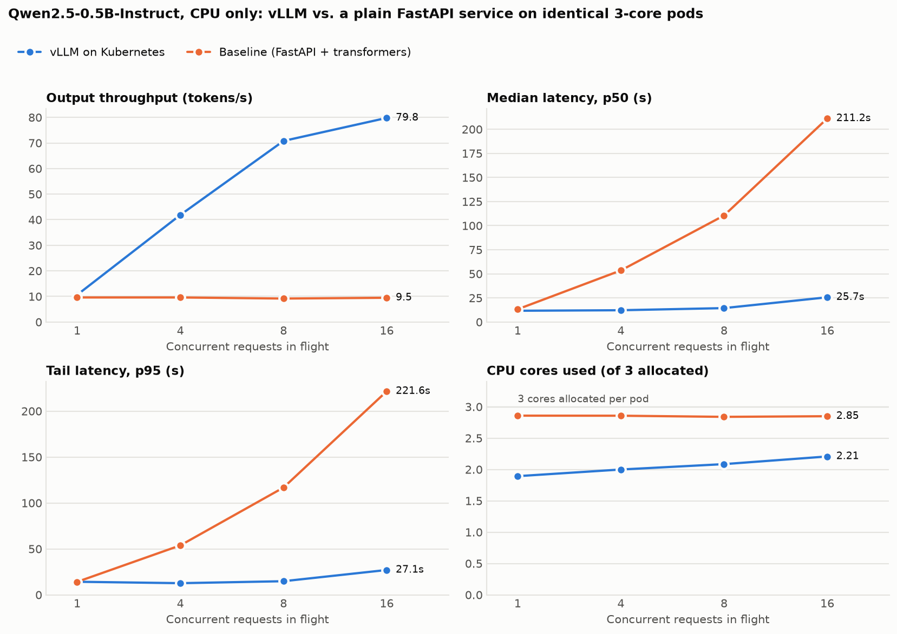

# Benchmark results: vLLM vs. FastAPI baseline

_Generated 2026-10-08T04:48:44+00:00 by `bench/report.py` from the raw runs in `results/raw/`. Do not edit by hand._

## Setup

- **Model:** Qwen/Qwen2.5-0.5B-Instruct (bfloat16)
- **Accelerator:** none -- CPU only (no GPU was used)
- **Host:** Apple M3 Pro, Darwin 27.0.0
- **Cluster:** 1 node (kind, Kubernetes v1.37.0), 9 vCPUs / 8.7 GiB in a Colima VM
- **Per-pod resources (both deployments):** 3 dedicated CPU cores (Guaranteed QoS + static CPU manager); memory 3840Mi (vLLM) / 2Gi (baseline)
- **Images:** `kubeserve-vllm:v1` / `kubeserve-baseline:v1`
- **Workload:** closed loop at concurrency 1, 4, 8, 16; N = max(16, 4×concurrency) requests per level; every request generates exactly 128 tokens (greedy, `ignore_eos`); fixed prompt set (~43 prompt tokens each)
- **Runs:** vLLM 2 complete sweeps, baseline 1 complete sweep. Values are means; where runs differ, the min–max range across runs is shown in parentheses

## Throughput and latency

| Concurrency | Baseline tok/s | vLLM tok/s | **Throughput gain** | Baseline p50 (s) | vLLM p50 (s) | Baseline p95 (s) | vLLM p95 (s) | **p95 reduction** |
|---:|---:|---:|---:|---:|---:|---:|---:|---:|
| 1 | 9.6 | 10.6 (10.3–10.9) | **1.10×** | 13.2 | 11.7 (11.1–12.3) | 14.1 | 14.2 (14.1–14.3) | **0.99×** |
| 4 | 9.6 | 41.9 (40.5–43.2) | **4.36×** | 53.5 | 12.2 (11.7–12.7) | 53.8 | 12.7 (12.3–13.1) | **4.24×** |
| 8 | 9.2 | 70.8 (69.7–71.9) | **7.71×** | 110.5 | 14.4 (14.2–14.7) | 116.8 | 14.8 (14.4–15.3) | **7.88×** |
| 16 | 9.5 | 79.8 (77.2–82.4) | **8.42×** | 211.2 | 25.7 (24.8–26.5) | 221.6 | 27.1 (25.1–29.0) | **8.19×** |

| Concurrency | Baseline req/s | vLLM req/s | Failed requests (baseline / vLLM) |
|---:|---:|---:|---:|
| 1 | 0.075 | 0.083 (0.081–0.085) | 0 of 16 / 0 of 32 |
| 4 | 0.075 | 0.327 (0.317–0.338) | 0 of 16 / 0 of 32 |
| 8 | 0.072 | 0.553 (0.545–0.561) | 0 of 32 / 0 of 64 |
| 16 | 0.074 | 0.623 (0.603–0.643) | 0 of 64 / 0 of 128 |

## CPU utilisation (in place of GPU utilisation: no GPU)

Measured from each pod's cgroup counters (`cpu.stat`) over the load window. Utilisation is relative to the pod's 3-core allocation.

| Concurrency | Baseline cores used | vLLM cores used | Baseline CPU util. | vLLM CPU util. | Baseline tok/s per core | vLLM tok/s per core | Peak memory baseline / vLLM (MiB) |
|---:|---:|---:|---:|---:|---:|---:|---:|
| 1 | 2.86 | 1.89 | 95% | 63% | 3.4 | 5.6 | 1620 / 3338 |
| 4 | 2.86 | 2.00 | 95% | 67% | 3.4 | 20.9 | 1619 / 3340 |
| 8 | 2.84 | 2.08 | 95% | 70% | 3.2 | 33.9 | 1619 / 3349 |
| 16 | 2.85 | 2.21 | 95% | 74% | 3.3 | 36.2 | 1619 / 3363 |

